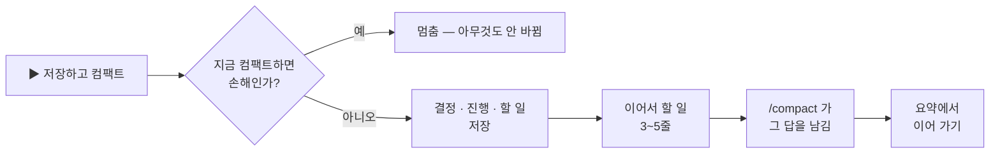

<p align="center">
  
</p>

<h1 align="center">easy-compact</h1>

<p align="center">
  <b>요청마다 얼마 드는지 보고, 언제 컴팩트할지 알고, 클릭 한 번으로 컴팩트합니다 — 하던 일을 잃지 않고.</b><br>
  Claude Code 플러그인 · 데스크톱 앱과 터미널 · Windows 에서 시험함
</p>

<p align="center">
  
  
  
  
</p>

<p align="center">
  <a href="README.md">English</a> · <b>한국어</b>
  &nbsp;|&nbsp;
  <a href="#설치">설치</a> · <a href="#새-판-받기">새 판 받기</a> · <a href="#030-에서-바뀐-것">바뀐 것</a> · <a href="#기능">기능</a> · <a href="#숨기기--접기--다시-켜기">숨기기 · 다시 켜기</a>
</p>

---

## 설치

**처음 한 번만.** Claude Code **2.1.295 이상**. 데스크톱 앱과 터미널은 같은 설정을 써서, 한 곳에서 설치하면 둘 다 됩니다.

Claude Code — 데스크톱 앱 Code 탭이든 터미널이든 — 에서 한 줄씩 입력하세요.

```
/plugin marketplace add JaeSeongHa5280/easy-compact
/plugin install easy-compact@easy-compact
```

- **데스크톱 앱:** 첫 줄을 치면 **마켓플레이스 추가** 창이 뜹니다 — **동기화** 를 누르세요. 빨간 경고는 Anthropic 이 운영하지 않는 마켓이면 늘 뜨는 안내입니다. 둘째 줄을 치면 플러그인 목록에 easy-compact 가 보입니다 — 설치하세요.
- **터미널:** 둘째 줄을 치면 플러그인 정보가 열립니다 — **Install for you** 를 고르세요.

그다음 Claude 앱을 완전히 껐다 켜거나 새 `claude` 세션을 엽니다. 입력창 위에 이지 컴팩트 바가 뜹니다.

**Claude 에게 맡겨도 됩니다:** Code 세션에 `https://github.com/JaeSeongHa5280/easy-compact 설치해줘` 를 보내세요.

> **Claude 에게:** `claude` 가 PATH 에 없으면(데스크톱 앱이면 보통) 지금 도는 엔진으로 돌리세요 — Windows PowerShell: `& (Get-Process -Id $env:CLAUDE_PID).Path plugin install easy-compact --marketplace JaeSeongHa5280/easy-compact`. 이미 설치된 것을 업데이트할 땐 같은 엔진 경로로 `plugin marketplace update easy-compact` 를 먼저, 그다음 `plugin update easy-compact@easy-compact` — 첫 단계 없이는 옛 판을 최신이라고 답합니다. `plugin list` 에서 `easy-compact@easy-compact` 가 enabled 인지 보고, 앱을 완전히 껐다 켜 달라고 안내하세요. 이 저장소를 clone 하거나 `settings.json` 을 고치지 마세요.

## 새 판 받기

**이미 설치했다면 이 두 줄을 복사해** 터미널에 붙여 넣고, Claude 를 다시 켜세요.

```
claude plugin marketplace update easy-compact
claude plugin update easy-compact@easy-compact
```

- 설치 줄을 다시 치면 "이미 설치됨"만 나오고, `plugin update` 만 치면 옛 판을 최신이라고 답합니다 — 첫 줄이 새 목록을 받아 옵니다.
- **데스크톱 앱만 쓰고 `claude` 명령이 없으면:** Code 세션에 `https://github.com/JaeSeongHa5280/easy-compact 업데이트해줘` 를 보내세요.
- **새 판을 저절로 받으려면:** 터미널 세션에서 `/plugin` → **Marketplaces** → **easy-compact** → **Enable auto-update**. Anthropic 이 운영하지 않는 마켓은 꺼진 채로 시작합니다([Claude Code 문서](https://code.claude.com/docs/en/plugins/install)).
- 내 판 번호: `claude plugin list`. 무엇이 바뀌었나: [변경 기록](CHANGELOG.ko.md) · [릴리스](https://github.com/JaeSeongHa5280/easy-compact/releases).

<details>
<summary><b>지우기</b></summary>

```
claude plugin uninstall easy-compact@easy-compact
```

`~/.claude` 에 clone 하거나 `settings.json` 을 고친 것이 없어 이것으로 끝입니다. 잠깐 쉬고 싶을 뿐이면 지우는 대신 [바를 끄세요](#숨기기--접기--다시-켜기).

</details>

## 0.3.0 에서 바뀐 것

- **바의 창 버튼** — 📊 사용량 패널 · ⇲ 자동 숨김 · — / □ 한 줄 / 전체 · ✕ 끄기, 마우스를 올리면 설명.
- **입력창 아래 🔽 이지 컴팩트 ⇱** 로 접히거나 꺼 둔 바를 다시 폅니다. 끄면 다시 켜는 법을 알려 줍니다.
- **🗜 가 회색이면 "아직 아님"** — 구간 전, 방금 컴팩트함, 컴팩트가 더 비쌀 때. 마우스를 올리면 까닭, 누르면 카드에 숫자가 그대로 나옵니다.
- **캐시 만료 고침:** 세션을 다시 열어도 만료된 캐시가 가려지지 않아, *캐시 만료 · 바로 컴팩트 권장* 이 제때 뜹니다.
- 사용량 패널 옵션: 새 세션에서 자동으로 열기 · 세션끼리 같이 열고 닫기.

전체 목록: [변경 기록](CHANGELOG.ko.md).

## 왜 필요한가

Claude Code 는 요청마다 컨텍스트 전체를 다시 읽습니다. 300k 세션은 한 걸음마다 300k 값을 내는데, 화면엔 아무 표시가 없습니다.

| easy-compact 없이 | easy-compact 와 |
|---|---|
| `/context` 를 치고 또 치기 | 컨텍스트 · 비용이 **늘 화면에** |
| *"이거 얼마 들었지?"* | **요청 · 질문 · 동작마다** 비용 |
| *"지금 컴팩트할까, 나중에?"* | 🟡 **좋은 때** · 🔴 **늦어짐** · 회색 🗜 = 아직 |
| 컴팩트 뒤 *"어디까지 했더라?"* | 요약에 **이어서 할 일**이 남음 |

## 데모 · 45초

https://github.com/user-attachments/assets/cd8fd962-4361-4056-9372-fa321d3dda42

## 기능

### 1. 입력창 바로 위, 실시간 비용


**컨텍스트 · 다음 요청 값 · 이번 질문 값 — 요청이 끝날 때마다 바뀝니다.**
바에는 5시간 · 7일 요금제 사용량, 캐시 남은 분, **이지 컴팩트** 버튼, 창 버튼(오른쪽 위)도 있습니다. 거슬리면 한 줄로 줄이거나, 컴팩트할 때까지 자동으로 숨기거나, 끄세요 — [숨기기 · 접기 · 다시 켜기](#숨기기--접기--다시-켜기). 전체 바의 칸을 하나씩 빼려면 설정 → **이지 컴팩트 바** → **UI 레이아웃 상세 조정**.

### 2. 질문별 비용, 동작마다


**Claude 가 일하는 동안, 동작마다 한 줄과 금액이 붙습니다.**


**끝난 질문은 펼쳐 봅니다:** 읽기 · 쓰기 · 출력, 그리고 동작별 값. `(+42k)` 는 그 질문이 늘린 컨텍스트입니다.

### 3. 언제 컴팩트할지


**비용표에서 컴팩트 구간을 고릅니다.** 크기마다 요청 1회 값, 캐시가 식었을 때 값, 가장 싼 크기(★)보다 얼마나 더 드는지가 보입니다.

| 🗜 와 버튼 | 뜻 |
|---|---|
| 회색 🗜 · 보통 **이지 컴팩트** | 아직 아님 — 구간 전, 방금 컴팩트함, 컴팩트가 더 비쌈. 마우스를 올리면 까닭 |
| 🟡 *컴팩트하기 좋은 때* | 구간 안 |
| 🔴 *컴팩트 늦어짐* | 구간을 넘음 |
| 🔵 *캐시 만료 · 바로 컴팩트 권장* | 캐시가 식었고, 지금 컴팩트하는 쪽이 전체를 다시 보내는 것보다 쌈 |

### 4. 저장하고 컴팩트 — 클릭 한 번


**"컴팩트할까요?" 카드에 질문당 아끼는 값과 컴팩트 비용이 보입니다**(캐시가 식었으면 그냥 이어 가기와 바로 컴팩트의 값). 누르면:




**컴팩트 뒤 요약에 이어서 할 일이 남고, 그 뒤 요청은 모두 싸집니다.** *바로 컴팩트* 는 저장 단계를 건너뜁니다.

### 5. 사용량 패널

바의 **📊** 로 엽니다: 질문 · 동작별 비용, 컨텍스트 흐름, 컴팩트마다 아낀 값. 기본은 떠 있는 데스크톱 세션끼리 같이 열고 닫고, 새 세션에서 저절로 열리지는 않습니다 — 둘 다 설정 → **사용량 패널** 에서 바꿉니다.

### 6. 터미널에서도


**CLI 에서도 같은 바와 사용량 패널.** 바의 버튼은 ctrl+x tab 으로 바에 들어가 누릅니다(전체 화면 모드면 클릭).

## 숨기기 · 접기 · 다시 켜기

창 버튼은 바의 오른쪽 위에 있습니다. 고른 것은 모든 세션에 적용되고, 앱을 껐다 켜도 남습니다.

| 버튼 | 하는 일 | 다시 돌아오는 법 |
|---|---|---|
| **⇲** 자동 숨김 | 컨텍스트가 컴팩트 구간(노랑)에 닿을 때까지 바를 접습니다 | 노랑이 되면 저절로 — 또는 입력창 아래 **🔽 이지 컴팩트 ⇱** |
| **—** / **□** | 한 줄 / 전체 | 다시 누르기 |
| **✕** 끄기 | 모든 세션에서 바를 끕니다 — 지울지 정하기 전에 잠시 쉬는 용도 | 입력창 아래 **🔽 이지 컴팩트 닫힘 ⇱**(회색)을 누르거나 `/easy-compact 보이기` |
| **📊** | 사용량 패널 열기 · 닫기 | 다시 누르기 |


**명령은 `/easy-compact 보이기` · `안보이기` 둘뿐입니다**(영어 `show` · `hide`) — 바를 꺼 둔 뒤 다시 켤 때 쓰세요. 나머지는 바의 버튼과 📊 패널의 **⚙ 설정** 탭에서 합니다. 설정 칸은 처음엔 접혀 있고, 제목 줄에 지금 값이 보입니다.

**버튼은 토큰을 쓰지 않습니다.** 명령도 모델을 부르지는 않지만, 친 명령과 한 줄 답이 대화에 남아 다음 요청 때 같이 보내집니다.

## 알아 둘 것

- **금액은 API 정가 환산입니다.** 구독 요금제라면 청구액이 아니라 세션이 얼마나 무거운지로 읽으세요.
- **모든 것이 내 PC 안에서 돕니다.** 로컬 세션 기록만 읽고 네트워크 요청은 하지 않습니다.
- **운영체제:** Windows 에서 만들고 시험했습니다. Windows 에만 묶인 곳은 없지만 macOS · Linux 는 아직 시험하지 않았습니다 — 써 보고 알려 주시면 반영합니다.
- **데스크톱 앱:** 패널을 연 직후 패널 안 첫 클릭은 포커스만 옮깁니다. 한 번 더 누르세요.
- 4MB 가 넘는 기록은 Node.js 로 읽습니다. 아주 긴 세션이면 `node` 가 PATH 에 있어야 합니다.

## 라이선스

[MIT](LICENSE)
