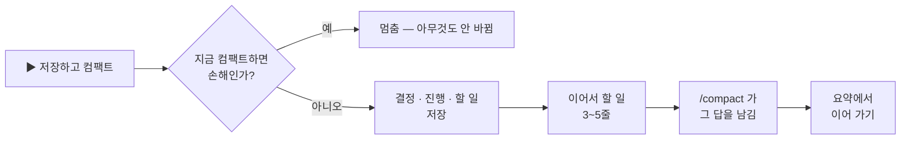

<p align="center">
  
</p>

<h1 align="center">easy-compact</h1>

<p align="center">
  <b>요청마다 얼마 드는지 보고, 언제 컴팩트할지 알고, 클릭 한 번으로 컴팩트합니다 — 하던 일을 잃지 않고.</b><br>
  Claude Code 플러그인 · <b>Windows 전용</b> · 데스크톱 앱과 터미널
</p>

<p align="center">
  
  
  
</p>

<p align="center">
  <a href="README.md">English</a> · <b>한국어</b>
  &nbsp;|&nbsp;
  <a href="#설치">설치</a> · <a href="#기능">기능</a> · <a href="#명령">명령</a>
</p>

---

## 설치

Windows 전용 · Claude Code **2.1.295 이상**. 데스크톱 앱과 터미널은 같은 설정을 써서, 한 곳에서 설치하면 둘 다 됩니다.

Claude Code — 데스크톱 앱 Code 탭이든 터미널이든 — 에서 한 줄씩 입력하세요.

```
/plugin marketplace add JaeSeongHa5280/easy-compact
/plugin install easy-compact@easy-compact
```

- **데스크톱 앱:** 첫 줄을 치면 **마켓플레이스 추가** 창이 뜹니다 — **동기화** 를 누르세요. 빨간 경고는 Anthropic 이 운영하지 않는 마켓이면 늘 뜨는 안내입니다. 둘째 줄을 치면 플러그인 목록에 easy-compact 가 보입니다 — 설치하세요.
- **터미널:** 둘째 줄을 치면 플러그인 정보가 열립니다 — **Install for you** 를 고르세요.

그다음 Claude 앱을 완전히 껐다 켜거나 새 `claude` 세션을 엽니다. 입력창 위에 띠가 뜹니다.

**Claude 에게 맡겨도 됩니다:** Code 세션에 `https://github.com/JaeSeongHa5280/easy-compact 설치해줘` 를 보내세요.

> **Claude 에게:** 데스크톱 앱에선 보통 `claude` 가 PATH 에 없으니, PowerShell 에서 지금 도는 엔진으로 설치하세요: `& (Get-Process -Id $env:CLAUDE_PID).Path plugin install easy-compact --marketplace JaeSeongHa5280/easy-compact`. `plugin list` 에서 `easy-compact@easy-compact` 가 enabled 인지 보고, 앱을 완전히 껐다 켜 달라고 안내하세요. 이 저장소를 clone 하거나 `settings.json` 을 고치지 마세요. 이미 설치된 것을 업데이트할 땐 같은 엔진 경로로 `plugin marketplace update easy-compact` 를 먼저, 그다음 `plugin update easy-compact@easy-compact` — 첫 단계 없이는 옛 판을 최신이라고 답합니다.

<details>
<summary><b>확인 · 업데이트 · 지우기</b></summary>

- **확인:** `claude plugin list` 에서 `easy-compact@easy-compact` 가 **enabled**. `claude --version` 이 2.1.295 보다 낮으면 먼저 `claude update`.
- **업데이트:** 마켓 목록을 먼저 새로 받고, 업데이트한 뒤, Claude 를 다시 켭니다.
  ```
  claude plugin marketplace update easy-compact
  claude plugin update easy-compact@easy-compact
  ```
  설치 줄을 다시 치면 "이미 설치됨"만 나오고, `plugin update` 만 치면 옛 판을 최신이라고 답합니다 — Anthropic 밖 마켓은 목록을 스스로 새로 받지 않습니다. 데스크톱 앱에선 Code 세션에 `https://github.com/JaeSeongHa5280/easy-compact 업데이트해줘` 를 보내도 됩니다.
- **지우기:** `claude plugin uninstall easy-compact@easy-compact`

`~/.claude` 에 clone 하거나 `settings.json` 을 고칠 필요는 없습니다.

</details>

## 왜 필요한가

Claude Code 는 요청마다 컨텍스트 전체를 다시 읽습니다. 300k 세션은 한 걸음마다 300k 값을 내는데, 화면엔 아무 표시가 없습니다.

| easy-compact 없이 | easy-compact 와 |
|---|---|
| `/context` 를 치고 또 치기 | 컨텍스트 · 비용이 **늘 화면에** |
| *"이거 얼마 들었지?"* | **요청 · 질문 · 동작마다** 비용 |
| *"지금 컴팩트할까, 나중에?"* | 🟡 **좋은 때** · 🔴 **늦어짐** |
| 컴팩트 뒤 *"어디까지 했더라?"* | 요약에 **이어서 할 일**이 남음 |

## 데모 · 45초

https://github.com/user-attachments/assets/cd8fd962-4361-4056-9372-fa321d3dda42

## 기능

### 1. 입력창 바로 위, 실시간 비용


**컨텍스트 · 다음 요청 값 · 이번 질문 값 — 요청이 끝날 때마다 바뀝니다.**
띠에는 5시간 · 7일 요금제 사용량, 캐시 남은 분, **이지 컴팩트** 버튼도 있습니다.

**띠가 거슬리면 보기를 고르세요.**

| 보기 | 보이는 것 |
|---|---|
| **전체 보기** | 위 전부. 5시간 · 7일 한도, 리셋 시간, 캐시, 질문 줄 같은 칸은 설정 → **UI 레이아웃 상세 조정** 에서 뺍니다 |
| **최소화** | 한 줄: 요청당 · 컨텍스트 · 컴팩트 구간 |
| **컴팩트할 때만** | 컨텍스트가 컴팩트 구간에 닿기 전엔 입력창 위에 아무것도 없고, 닿으면 한 줄과 **이지 컴팩트** 버튼 |

띠의 **▾ 최소화** 버튼, 설정 탭, `/easy-compact 띠` 명령으로 바꿉니다.

### 2. 질문별 비용, 동작마다


**Claude 가 일하는 동안, 동작마다 한 줄과 금액이 붙습니다.**


**끝난 질문은 펼쳐 봅니다:** 읽기 · 쓰기 · 출력, 그리고 동작별 값. `(+42k)` 는 그 질문이 늘린 컨텍스트입니다.

### 3. 언제 컴팩트할지


**비용표에서 컴팩트 구간을 고릅니다.** 크기마다 요청 1회 값, 캐시가 식었을 때 값, 가장 싼 크기(★)보다 얼마나 더 드는지가 보입니다. 구간에 들어서면 띠가 🟡 *컴팩트하기 좋은 때*, 넘으면 🔴 *컴팩트 늦어짐* 으로 바뀝니다.

### 4. 저장하고 컴팩트 — 클릭 한 번


**"컴팩트할까요?" 카드에 질문당 아끼는 값과 컴팩트 비용이 보입니다.** 누르면:




**컴팩트 뒤 요약에 이어서 할 일이 남고, 그 뒤 요청은 모두 싸집니다.** *바로 컴팩트* 는 저장 단계를 건너뜁니다.

### 5. 터미널에서도


**CLI 에서도 같은 띠와 사용량 패널.** 패널은 `/easy-compact usage` 로 엽니다.

## 명령

모두 띠나 패널의 버튼으로도 됩니다.

<details>
<summary><b>명령 전체</b></summary>

| 명령 | 하는 일 |
|---|---|
| `/easy-compact usage` | 사용량 패널 열기 · 닫기 |
| `/easy-compact settings` | 설정 탭 열기 |
| `/easy-compact set 구간 <시작> <끝>` | 컴팩트 구간(예: `set 구간 25만 30만`, 영어 `set range 250k 300k`) |
| `/easy-compact set 권장 <크기>` | 컴팩트 크기 직접 지정(10만~100만) |
| `/easy-compact set 권장 구간` | 구간 방식으로 되돌리기 |
| `/easy-compact set 캐시 <분>` | 캐시가 이만큼 남으면 노랑 |
| `/easy-compact 문구 <일반 \| 긴 세션 이어가기 \| 마무리 \| 직접 \| 직접 쓸 글>` | 저장하고 컴팩트 문구 |
| `/easy-compact 띠 <전체 \| 최소화 \| 컴팩트할때만>` | 띠 보기(영어 `band <full \| min \| auto>`) |
| `/easy-compact 띠 <칸> <켜기 \| 끄기>` | 전체 보기 띠의 칸: `5시간` `7일` `리셋` `요청당` `컨텍스트` `구간` `캐시` `질문`(`모두` = 전부) |
| `/easy-compact lang <auto \| ko \| en>` | 화면 언어 |
| `/easy-compact hide` · `show` | 이 세션에서 띠 숨기기 · 보이기 |

</details>

## 알아 둘 것

- **금액은 API 정가 환산입니다.** 구독 요금제라면 청구액이 아니라 세션이 얼마나 무거운지로 읽으세요.
- **모든 것이 내 PC 안에서 돕니다.** 로컬 세션 기록만 읽고 네트워크 요청은 하지 않습니다.
- **데스크톱 앱:** 패널을 연 직후 패널 안 첫 클릭은 포커스만 옮깁니다. 한 번 더 누르세요.
- **컴팩트할 때만** 보기에선 띠의 버튼도 숨습니다. 사용량 패널은 `/easy-compact usage` 로 엽니다.
- 4MB 가 넘는 기록은 Node.js 로 읽습니다. 아주 긴 세션이면 `node` 가 PATH 에 있어야 합니다.

## 라이선스

[MIT](LICENSE)
