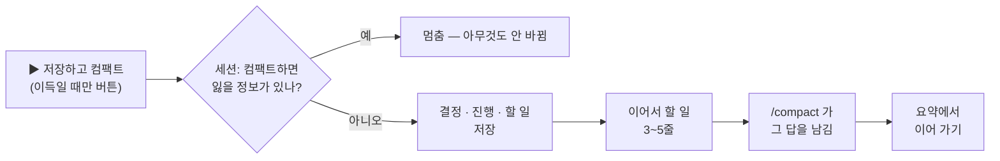

<p align="center">
  
</p>

<h1 align="center">easy-compact</h1>

<p align="center">
  <b>요청마다 얼마 드는지 보고, 언제 컴팩트할지 알고, 클릭 한 번으로 컴팩트합니다 — 하던 일을 잃지 않고.</b><br>
  Claude Code 플러그인 · 데스크톱 앱과 터미널 · Claude Code 2.1.295 이상
</p>

<p align="center">
  
  
  
  
</p>

<p align="center">
  <a href="README.md">English</a> · <b>한국어</b>
  &nbsp;|&nbsp;
  <a href="#필요한-것">필요한 것</a> · <a href="#설치">설치</a> · <a href="#새-판-받기">새 판 받기</a> · <a href="#050-에서-바뀐-것">바뀐 것</a> · <a href="#기능">기능</a> · <a href="#숨기기--접기--다시-켜기">숨기기 · 다시 켜기</a> · <a href="#바가-안-보이면">바가 안 보이면</a>
</p>

---

## 필요한 것

| | |
|---|---|
| **Claude Code** | **2.1.295 이상.** 데스크톱 앱: Code 탭 세션에서 `/status` → **Claude Code** 줄(앱 정보의 앱 판 번호가 아님). 터미널: `claude --version`. 낮은 판에선 바가 아예 안 뜰 수 있고, easy-compact 가 시작될 수 있으면 바 자리에 업데이트 안내 한 줄이 뜹니다. |
| **업데이트** | 데스크톱 앱: **Claude → Check for Updates**(macOS) · **Help → Check for Updates**(Windows) 뒤 새 세션. 터미널: `claude update`. Homebrew 의 `claude-code` 는 늦은 stable 채널이라 아직 낮습니다 — `brew install --cask claude-code@latest`. |
| **git** | GitHub 에서 마켓을 추가할 때 필요 — `git --version` 이 판을 찍으면 됩니다. macOS: 개발자 도구 설치 창이 뜨면 설치하세요. Windows: [Git for Windows](https://git-scm.com/downloads/win). |
| **보이는 곳** | Claude 데스크톱 앱(Code 탭)과 터미널의 `claude`. VS Code 확장 채팅 · `claude -p` · 클라우드 세션 · WSL 세션에선 안 보입니다. |
| **선택** | Node.js 14.8 이상 — 설치 전부터 이어 온 아주 긴 세션(기록 4MB 넘음)의 앞 구간까지 그리고, 오늘 · 이번 달 사용량(패널 모든 세션 줄 · 바 옵션)을 셉니다. |
| **시험한 곳** | Windows 11, 데스크톱 앱 · 터미널. OS 에 묶인 코드는 없지만 macOS · Linux 는 아직 실물로 시험하지 않았습니다 — 써 보고 알려 주세요. |

## 설치

**처음 한 번만.** 데스크톱 앱과 터미널은 같은 설정을 써서, 한 곳에서 설치하면 둘 다 됩니다.

**가장 쉬운 길 — Claude 에게 이 한 줄을 보내세요**(데스크톱 앱 Code 탭이든 터미널 세션이든):

```
이 플러그인 설치해줘: github.com/JaeSeongHa5280/easy-compact (claude plugin marketplace add JaeSeongHa5280/easy-compact 후 claude plugin install easy-compact@easy-compact)
```

그다음 Claude 앱을 완전히 껐다 켜거나 새 `claude` 세션을 엽니다. 입력창 위에 이지 컴팩트 바가 뜹니다.

<details>
<summary><b>직접 치려면</b></summary>

**Claude 입력창에서 — 한 줄씩 따로 보내세요.** 첫 줄이 끝난 뒤 둘째 줄을 보냅니다. 두 줄을 한 번에 붙여 보내면 설치가 안 됩니다.

```
/plugin marketplace add JaeSeongHa5280/easy-compact
```

```
/plugin install easy-compact@easy-compact
```

- **데스크톱 앱:** 첫 줄을 치면 **마켓플레이스 추가** 창이 뜹니다 — **동기화** 를 누르세요. 빨간 경고는 Anthropic 이 운영하지 않는 마켓이면 늘 뜨는 안내입니다. 둘째 줄을 치면 플러그인 목록에 easy-compact 가 보입니다 — 설치하세요.
- **터미널 세션:** 둘째 줄을 치면 플러그인 정보가 열립니다 — **Install for you** 를 고르세요.

**터미널(macOS 터미널 · Windows PowerShell)에서:**

```
claude plugin marketplace add JaeSeongHa5280/easy-compact
claude plugin install easy-compact@easy-compact
```

`claude` 명령이 없으면(데스크톱 앱만 쓰면 보통) 위의 한 줄을 Claude 에게 보내세요.

</details>

> **Claude 에게:** 먼저 엔진 판이 2.1.295 이상인지 보세요(`<엔진> --version`). 낮으면 설치하지 말고 위 [필요한 것](#필요한-것)의 업데이트 길을 안내하세요. `claude` 가 PATH 에 없으면(데스크톱 앱이면 보통) 지금 도는 엔진으로 돌리세요 — 엔진 경로는 `CLAUDE_CODE_EXECPATH`, 없으면 `CLAUDE_PID` 의 실행 파일입니다. macOS · Linux: `"$CLAUDE_CODE_EXECPATH" plugin marketplace add JaeSeongHa5280/easy-compact` 다음 `"$CLAUDE_CODE_EXECPATH" plugin install easy-compact@easy-compact`. Windows PowerShell: `& $env:CLAUDE_CODE_EXECPATH plugin marketplace add JaeSeongHa5280/easy-compact` 다음 `& $env:CLAUDE_CODE_EXECPATH plugin install easy-compact@easy-compact`(변수가 없으면 `(Get-Process -Id $env:CLAUDE_PID).Path`). `git` 이 없어 마켓 추가가 실패하면 git 설치를 안내하세요(macOS 는 `xcode-select --install`). 이미 설치된 것을 업데이트할 땐 같은 엔진 경로로 `plugin marketplace update easy-compact` 를 먼저, 그다음 `plugin update easy-compact@easy-compact` — 첫 단계 없이는 옛 판을 최신이라고 답합니다. `plugin list` 에서 `easy-compact@easy-compact` 가 enabled 인지 보고, 앱을 완전히 껐다 켜 달라고 안내하세요. 이 저장소를 clone 하거나 `settings.json` 을 고치지 마세요.

## 새 판 받기

**0.5.0 부터는 앱 안에서:** 바의 **📊** → **⚙ 설정** 탭 맨 아래 **easy-compact** 칸 → **[업데이트 확인]** → 새 판이면 **[업데이트]** → Claude 를 다시 켜기. 누를 때만 Claude Code 가 GitHub 에서 마켓을 받아 옵니다. 새 판이 이미 받아져 있으면 설정 탭 이름에 점(•)이 붙습니다.

**0.4.1 이하이거나 직접 하려면 Claude 에게 이 한 줄을 보내고**, Claude 를 다시 켜세요.

```
이 플러그인 업데이트해줘: easy-compact (claude plugin marketplace update easy-compact 후 claude plugin update easy-compact@easy-compact)
```

셸에서 직접 하려면 이 두 줄입니다:

```
claude plugin marketplace update easy-compact
claude plugin update easy-compact@easy-compact
```

- 설치 줄을 다시 치면 "이미 설치됨"만 나오고, `plugin update` 만 치면 옛 판을 최신이라고 답합니다 — 첫 줄이 새 목록을 받아 옵니다.
- 쓰던 설정(컴팩트 구간 · 고른 화면 등)은 그대로 남습니다. 0.4.0 의 **기본** 화면은 없어져 **간단** 으로 바뀝니다.
- **새 판을 저절로 받으려면:** 터미널 세션에서 `/plugin` → **Marketplaces** → **easy-compact** → **Enable auto-update**. Anthropic 이 운영하지 않는 마켓은 꺼진 채로 시작합니다([Claude Code 문서](https://code.claude.com/docs/en/plugins/install)).
- 내 판 번호: `claude plugin list`. 무엇이 바뀌었나: [변경 기록](CHANGELOG.ko.md) · [릴리스](https://github.com/JaeSeongHa5280/easy-compact/releases).

<details>
<summary><b>지우기</b></summary>

```
claude plugin uninstall easy-compact@easy-compact
```

`~/.claude` 에 clone 하거나 `settings.json` 을 고친 것이 없어 이것으로 끝입니다. 잠깐 쉬고 싶을 뿐이면 지우는 대신 [바를 끄세요](#숨기기--접기--다시-켜기).

</details>

## 0.5.1 에서 바뀐 것

- **사용량 패널 맨 위 "모든 세션" 줄** — `모든 세션  오늘 ~$65 · 이번 달 ~$788`(이 PC 의 모든 세션, API 정가)이 바로 아래 **이 세션 · 누적 $** 와 짝으로 보입니다. 자세히 보기는 옵션과 상관없이 늘, 간단 보기는 설정에서 켠 것만.
- **바 이름표 "세션"** — 비용 줄 첫 칸 *이 세션* → **세션**. 옆 이름표(오늘 · 이번 달 · 요청당)와 나란해지고 좁은 바에서 칸이 하나 더 남습니다. 패널 첫 카드 제목은 **이 세션** 그대로.
- **설정 줄 이름 "모든 세션"** — 모든 화면 공통의 *전체 사용량* → **모든 세션**. 켜면 바와 간단 패널에도 보입니다.

17초 소개 영상은 [v0.5.1 릴리스 페이지](https://github.com/JaeSeongHa5280/easy-compact/releases/tag/v0.5.1)에 있습니다(화면 글은 영어). 전체 목록: [변경 기록](CHANGELOG.ko.md).

<details>
<summary><b>0.5.0 에서 바뀐 것</b></summary>

- **패널 · 창 크기에 맞춥니다** — 카드가 패널 폭을 꽉 채우고 막대 · 그래프도 카드 폭까지 늘어납니다. 좁아지면 낱말 중간에서 꺾이지 않고 덜 중요한 칸부터 뺍니다(바 · 설정 비용표).
- **한 벌의 아이콘 · 뜻 하나의 색** — 카드 제목 · 바 · 확인 카드의 그림 글자를 선 아이콘으로(데스크톱). 진행은 파랑, 주의는 노랑 하나, 손해 · 늦어짐 · 캐시 만료는 빨강, ★ 최적은 초록.
- **오늘 · 이번 달 사용량**(옵션, 기본 끔) — 설정 → 화면 → 세부 → 모든 화면 공통의 **전체 사용량**(0.5.1 부터 **모든 세션**). 켜면 바에 `오늘 ~$65 · 이번 달 ~$788`(이 PC 의 모든 세션, API 정가).
- **앱 안에서 새 판 받기** — 설정 탭 맨 아래 **[업데이트 확인]** → **[업데이트]**. 새 판이 받아져 있으면 설정 탭 이름에 점, 업데이트한 뒤 처음 켜면 패널 맨 위에 *0.5.0 판으로 업데이트됨 · 바뀐 것 ▸*.
- **간단 보기의 "지금" 은 결정 한 줄** — 상태 + 숫자 하나 + 할 일. 이름도 정리했습니다: 패널 보기 **간단 · 자세히**, 바 크기 **전체 · 한 줄**, 첫 카드 **이 세션**.
- **고침** — 끝난 질문의 값이 다음 질문을 보낼 때 바뀌던 것(답 뒤 앱 자체 요청은 30초까지만 그 질문에).

33초 소개 영상은 [v0.5.0 릴리스 페이지](https://github.com/JaeSeongHa5280/easy-compact/releases/tag/v0.5.0)에 있습니다(화면 글은 영어).

</details>

<details>
<summary><b>0.4.1 에서 바뀐 것</b></summary>

- **화면은 셋 — 간단 · 자세히 · 커스텀.** **간단** 은 처음 쓰는 분, 토큰 · 캐시 같은 AI 비용 이야기가 낯선 분께 — 바는 한 줄(이 세션 금액 · 컨텍스트 · 캐시 · 이지 컴팩트), 패널 · 설정도 꼭 필요한 것만. **자세히** 는 AI 비용 구조를 아는 분께 — 한도 · 요청당 · 컴팩트 구간 · 질문 줄 · 그래프 · 비용표까지 전부. **커스텀** 은 바 칸과 **정보량**(최소 · 전부)을 직접 고릅니다. 처음 설치 · 업데이트 뒤 첫 화면은 간단입니다.
- **설정 화면 칸에 미리보기** — 고른 화면에서 입력창 위 바와 답변 끝 질문 비용 칩이 어떻게 보일지 바로 보입니다.
- **답변 끝 질문 비용은 파란 칩** — `🧾 이 질문 $0.61 · 요청 6회 · 🤖 에이전트 1개 $0.24 포함`. 자세히 화면에선 **▸ 자세히** 로 그 자리에서 펼쳐 메인 · 🤖 에이전트 · 🗜 컴팩트 · ⚙ 앱 자체 요청과 비싼 메인 동작을 봅니다.
- **질문 강조** — 답변 끝 질문 비용 칩이나 사용량 패널의 질문 줄에 마우스를 올리면 그 답변까지 함께 회색이 됩니다(데스크톱, 설정에서 끔).
- **모든 화면 공통: 한도 줄 · 세션 금액 색** — 화면 → 세부 아래에서 어느 화면에서나 바꿉니다. 요청이 끝났는데도 한도 값이 없는 세션이면 한도 줄 칸은 빠집니다.
- **캐시는 `캐시 만료까지 42분 남음`** — `42/60분` 보다 바로 읽힙니다(한 줄 바는 `캐시 만료 42분 남음`).
- **손해면 컴팩트하지 않게** — 캐시가 식었는데 그냥 이어 가는 편이 싸거나 아낄 게 거의 없으면, 이지 컴팩트 카드에 컴팩트 버튼 없이 *작업을 이어 가세요* 만 보입니다. 돈 판단은 easy-compact 가 숫자로 하고, 저장 질문을 받은 세션은 잃을 정보가 있는지만 봅니다(전엔 세션이 "메모리에 저장해 둬 잃을 게 없다" 며 손해인 컴팩트를 진행했습니다).
- **질문별 비용을 덜 헷갈리게** — 간략은 질문마다 `요청 N회 · 🤖 에이전트 N개` 한 줄, 자세히는 `🤖 에이전트 1개 $3.56 포함` 이고 펼치면 메인 · 에이전트로 나눠 보입니다.
- **비용표 `질문 1개(10회 가정)`** — 질문 하나 = 요청 10회로 고정해 기준점이 흔들리지 않게, 이 세션 평균 요청 수와 그 수로 센 값도 풀이 줄에 색으로.
- 패널 위 **간략 · 자세히** 는 잠깐 보기 — 패널을 닫거나 설정에 다녀오면 정보량대로. 설정 칸 펼침도 패널을 닫으면 처음대로(화면과 그 세부만 펼침).
- **macOS 준비** — 설명 문구의 "Windows" 를 빼고 [필요한 것](#필요한-것)을 적었습니다. 엔진이 2.1.295 보다 낮으면(예: Homebrew stable) 시작될 수 있는 한 바 자리에 업데이트 안내 한 줄, `node` 가 없어 긴 기록의 앞 구간을 못 읽으면 그렇게 알립니다.
- 뺀 것: 질문 평균 칸 · 답변 아래 🤖 옵션(화면을 따름) · 0.4.0 의 **기본** 화면(→ 간단).

35초 소개 영상은 [v0.4.1 릴리스 페이지](https://github.com/JaeSeongHa5280/easy-compact/releases/tag/v0.4.1)에 있습니다(화면 글은 영어).

</details>

## 왜 필요한가

Claude Code 는 요청마다 컨텍스트 전체를 다시 읽습니다. 300k 세션은 한 걸음마다 300k 값을 내는데, 화면엔 아무 표시가 없습니다.

| easy-compact 없이 | easy-compact 와 |
|---|---|
| `/context` 를 치고 또 치기 | 컨텍스트 · 비용이 **늘 화면에** |
| *"이거 얼마 들었지?"* | **요청 · 질문 · 동작마다** 비용 |
| *"지금 컴팩트할까, 나중에?"* | 🟡 **좋은 때** · 🔴 **늦어짐** · 회색 🗜 = 아직 |
| 컴팩트 뒤 *"어디까지 했더라?"* | 요약에 **이어서 할 일**이 남음 |

## 데모 · 60초

https://github.com/user-attachments/assets/0926dba9-ce9f-42fe-a3c0-fef808131a56

## 기능

### 1. 입력창 바로 위, 실시간 비용


**컨텍스트 · 다음 요청 값 · 이번 질문 값 — 요청이 끝날 때마다 바뀝니다.**
바에는 세션 금액($10 · $50 · $100 을 넘으면 노랑 · 주황 · 빨강 — 설정에서 바꿈), 5시간 · 7일 요금제 사용량, 캐시 남은 시간(`캐시 만료까지 42분 남음`), **이지 컴팩트** 버튼, 창 버튼(오른쪽 위)도 있습니다. 처음엔 **간단** 화면이라 한 줄(세션 금액 · 컨텍스트 · 캐시 · 이지 컴팩트)입니다. 설정에서 켜면 오늘 · 이번 달 금액(이 PC 의 모든 세션)도 붙습니다 — 사용량 패널을 자세히로 보면 맨 위에 늘 있습니다. 다 보려면 설정 → **화면** 에서 **자세히**, 칸을 하나씩 고르려면 **커스텀** → **세부** — 고르는 동안 바 미리보기가 바뀝니다. 거슬리면 한 줄로 줄이거나 컴팩트할 때까지 접어 두세요 — [숨기기 · 접기 · 다시 켜기](#숨기기--접기--다시-켜기). 에이전트를 띄우면 그 몫이 `🤖 에이전트 1개 $X 포함` 으로 붙습니다.


**설정 → 화면: 간단 · 자세히 · 커스텀.** 고르는 동안 미리보기가 이 세션 값으로 바와 질문 비용 칩을 보여 줍니다. **정보량**(최소 · 전부)이 패널 · 설정 · 칩에 얼마나 보일지를 정합니다.

### 2. 질문별 비용, 동작마다


**Claude 가 일하는 동안, 동작마다 한 줄과 금액이 붙습니다.**


**끝난 질문은 펼쳐 봅니다**(자세히 보기): 메인(읽기 · 쓰기 · 출력) · 🤖 에이전트 · 🗜 컴팩트 · ⚙ 앱 자체 요청, 그리고 동작별 값. `(+42k)` 는 그 질문이 늘린 컨텍스트입니다. 간단 보기에선 펼치지 않고 질문마다 `요청 N회 · 🤖 에이전트 N개` 와 총액만 보입니다.


**답변마다 끝에 파란 칩 — 그 질문에 든 값.** 자세히 화면에선 **▸ 자세히** 로 그 자리에서 펼칩니다 — 메인 · 🤖 에이전트 · 🗜 컴팩트 · ⚙ 앱 자체 요청과 비싼 메인 동작. 칩이나 사용량 패널의 그 질문 줄에 **마우스를 올리면** 답변 · 칩 · 패널 줄이 함께 회색이 됩니다(데스크톱, 설정 → 화면 → 세부 → **질문 강조**).

### 3. 언제 컴팩트할지


**비용표에서 컴팩트 구간을 고릅니다.** 크기마다 읽기 1회 값과 질문 1개 값(요청 10회 가정 × 지금 모델 요율 — 이 세션 평균 요청 수도 풀이 줄에), 패널이 넓으면 캐시가 식었을 때 값과 가장 싼 크기(★)보다 얼마나 더 드는지도 보입니다(좁으면 덜 중요한 열부터 뺍니다). 간단 화면에선 크기 구간과 판정만 보입니다.

| 🗜 와 버튼 | 뜻 |
|---|---|
| 회색 🗜 · 보통 **이지 컴팩트** | 아직 아님 — 구간 전, 방금 컴팩트함, 컴팩트가 더 비쌈. 마우스를 올리면 까닭 |
| 🟡 *컴팩트하기 좋은 때* | 구간 안 |
| 🔴 *컴팩트 늦어짐* | 구간을 넘음 |
| 🔴 🧊 *캐시 만료* · **바로 컴팩트 권장** | 캐시가 식었고, 지금 컴팩트하는 쪽이 전체를 다시 보내는 것보다 쌈 |

### 4. 저장하고 컴팩트 — 클릭 한 번


**"컴팩트할까요?" 카드에 질문당 아끼는 값과 컴팩트 비용이 보입니다.** 캐시가 식었으면 🧊 *캐시 만료* 카드 — 그냥 이어 가기와 바로 컴팩트의 값, 주 버튼은 ▶ 바로 컴팩트(저장 질문이 먼저 전체를 다시 쓰기 때문). **지금 컴팩트하면 손해인 때**(식은 캐시인데 그냥 이어 가는 편이 싸거나, 아낄 게 거의 없을 때)엔 컴팩트 버튼 없이 *작업을 이어 가세요* 만 보입니다 — 돈 판단은 easy-compact 가 숫자로 하고, 세션에 맡기지 않습니다. **저장하고 컴팩트** 를 누르면:




**컴팩트 뒤 요약에 이어서 할 일이 남고, 그 뒤 요청은 모두 싸집니다.** *바로 컴팩트* 는 저장 단계를 건너뜁니다.

### 5. 사용량 패널


바의 **📊** 로 엽니다. **간단**(정보량 최소 — 간단 화면): **이 세션** — 누적 · 질문 수 · 메인 / 🤖 / ⚙ 와 *지금* 결정 한 줄(상태 · 숫자 하나 · 할 일) — 과 질문별 비용. **자세히**(정보량 전부 — 자세히 화면): 다른 모델로 했다면 · 컨텍스트 막대 · 컴팩트 시점 · 컨텍스트 흐름 · 컴팩트마다 아낀 값까지. 자세히 패널 맨 위엔 **모든 세션** 줄(이 PC 모든 세션의 오늘 · 이번 달)이 옵션과 상관없이 있고, 간단 패널엔 설정에서 켠 것만 보입니다. 탭 줄 오른쪽 **보기 [간단][자세히]** 로 잠깐 바꿔 볼 수 있습니다 — 패널을 닫거나 설정 탭에 다녀오면 정보량대로 돌아갑니다. 열 때 질문별 비용은 접혀 있습니다. 기본은 떠 있는 데스크톱 세션끼리 같이 열고 닫고, 새 세션에서 저절로 열리지는 않습니다 — 설정 → **바 · 패널** 에서 바꿉니다.

### 6. 터미널에서도


**CLI 에서도 같은 바와 사용량 패널.** 바의 버튼은 ctrl+x tab 으로 바에 들어가 누릅니다(전체 화면 모드면 클릭).

## 숨기기 · 접기 · 다시 켜기

창 버튼은 바의 오른쪽 위에 있습니다. 고른 것은 모든 세션에 적용되고, 앱을 껐다 켜도 남습니다.

| 버튼 | 하는 일 | 다시 돌아오는 법 |
|---|---|---|
| **—** / **□** | 한 줄 / 전체 | 다시 누르기 |
| **✕** 접기 | 모든 세션에서 바를 입력창 아래로 접습니다 | 컴팩트할 때(노랑 · 캐시 만료) 저절로 — 또는 입력창 아래 **🔽 이지 컴팩트 ⇱** 를 누르거나 `/easy-compact 보이기` |
| **📊** | 사용량 패널 열기 · 닫기 | 다시 누르기 |

접힌 바가 저절로 펴질지는 설정 → **바 · 패널** 의 **컴팩트할 때 저절로 펴기**(기본 켬)가 정합니다. 끄면 누를 때까지 접힌 채이고 입력창 아래 버튼이 회색(*닫힘*)이 됩니다 — 지울지 정하기 전에 잠시 쉬는 용도. 저절로 펴진 바를 다시 ✕ 로 접으면 더 급해질 때(빨강 · 캐시 만료)까지 기다립니다.


**명령은 `/easy-compact 보이기` · `안보이기` 둘뿐입니다**(영어 `show` · `hide`) — 접은 바를 펼 때 쓰세요. 나머지는 바의 버튼과 📊 패널의 **⚙ 설정** 탭에서 합니다. 설정은 맨 위 **화면** 칸(간단 · 자세히 · 커스텀)과 그 세부만 펼쳐져 있고, 나머지 칸은 제목 줄에 지금 값이 보입니다. 세부 아래 **모든 화면 공통** 에서 한도 줄 · 세션 금액 색 · 모든 세션(오늘 · 이번 달) · 질문 강조를 바꿉니다. 맨 아래 **easy-compact** 칸에서 새 판을 확인합니다. 캐시 유지 시간 자체(설정 파일의 `promptCacheTtl`)는 **커스텀**에서만 바꿉니다 — 대가를 모르고 고르면 손해만 봅니다.

**버튼은 토큰을 쓰지 않습니다.** 명령도 모델을 부르지는 않지만, 친 명령과 한 줄 답이 대화에 남아 다음 요청 때 같이 보내집니다.

## 바가 안 보이면

1. **판** — 2.1.295 이상이어야 합니다. 낮은 판은 바 자리에 업데이트 안내 한 줄이 뜨거나 아무것도 안 뜹니다 — [필요한 것](#필요한-것)의 방법으로 판을 보고 올리세요.
2. **설치됐나** — 터미널에서 `claude plugin list` → `easy-compact@easy-compact` 가 enabled 인지. 마켓 추가가 실패했으면 대개 `git` 이 없어서입니다.
3. **다시 켜기** — 데스크톱 앱은 창만 닫지 말고 완전히 끈 뒤 켜고, 새 세션을 엽니다. 터미널은 새 `claude` 세션.
4. **회사 관리 PC** — 관리자가 플러그인 · mod 를 막아 두었으면 뜨지 않습니다.

그래도 안 되면 [이슈](https://github.com/JaeSeongHa5280/easy-compact/issues)에 OS · `/status` 의 Claude Code 판 · 나온 오류 문구를 적어 주세요.

## 알아 둘 것

- **금액은 API 정가 환산입니다.** 구독 요금제라면 청구액이 아니라 세션이 얼마나 무거운지로 읽으세요.
- **모든 것이 내 PC 안에서 돕니다.** easy-compact 는 로컬 세션 기록만 읽고 스스로 네트워크 요청을 하지 않습니다. 설정 탭의 **[업데이트 확인]** · **[업데이트]** 를 누를 때만 Claude Code(`claude plugin` 명령)가 GitHub 에서 마켓을 받아 옵니다.
- **운영체제:** Windows 11 에서 만들고 시험했습니다. OS 에 묶인 코드는 없지만 macOS · Linux 는 아직 실물로 시험하지 않았습니다 — 써 보고 알려 주시면 반영합니다.
- **데스크톱 앱:** 패널을 연 직후 패널 안 첫 클릭은 포커스만 옮깁니다. 한 번 더 누르세요.
- 4MB 가 넘는 기록은 Node.js(14.8 이상)로 읽습니다. `node` 가 없으면 아주 긴 세션의 앞 구간은 빼고 설치한 뒤부터 그립니다(그렇다고 알려 줌). 오늘 · 이번 달 사용량도 Node.js 로 셉니다 — 없으면 바엔 그 칸이 뜨지 않고 패널 **모든 세션** 줄엔 *못 잼* 과 까닭이 나옵니다. 다른 세션 기록(토큰 수만)은 그 옵션을 켰거나 사용량 패널을 자세히로 볼 때만 읽습니다.

## 라이선스

[MIT](LICENSE)
