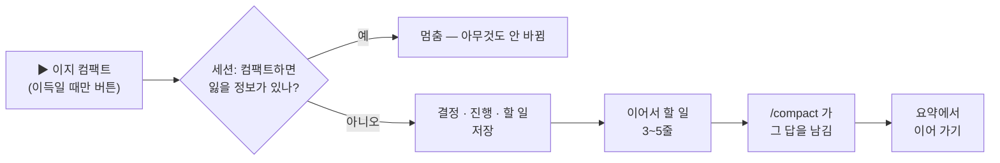

<p align="center">
  
</p>

<h1 align="center">easy-compact</h1>

<p align="center">
  <b>요청마다 얼마 드는지 보고, 언제 컴팩트할지 알고, 클릭 한 번으로 컴팩트합니다 — 하던 일을 잃지 않고.</b><br>
  Claude Code 플러그인 · 데스크톱 앱과 터미널 · Claude Code 2.1.295 이상
</p>

<p align="center">
  
  
  
  
</p>

<p align="center">
  <a href="README.md">English</a> · <b>한국어</b>
  &nbsp;|&nbsp;
  <a href="#필요한-것">필요한 것</a> · <a href="#설치">설치</a> · <a href="#업데이트-받기">업데이트 받기</a> · <a href="#114-에서-바뀐-것">바뀐 것</a> · <a href="#기능">기능</a> · <a href="#숨기기--접기--다시-켜기">숨기기 · 다시 켜기</a> · <a href="#바가-안-보이면">바가 안 보이면</a> · <a href="#문제가-생기면--제보">제보</a>
</p>

<p align="center">
  그림으로 보는 안내서: <a href="https://jaeseongha5280.github.io/easy-compact/primer/ko.html"><b>이지 컴팩트로 Claude Code 비용 줄이기</b></a> — Claude Code 요금이 어떻게 붙는지, 세션이 길수록 왜 비싸지는지, 어떻게 줄이는지
</p>

---

## 필요한 것

| | |
|---|---|
| **Claude Code** | **2.1.295 이상.** 데스크톱 앱: Code 탭 세션에서 `/status` → **Claude Code** 줄(앱 정보의 앱 버전 번호가 아님). 터미널: `claude --version`. 낮은 버전에선 바가 아예 안 뜰 수 있고, easy-compact 가 시작될 수 있으면 바 자리에 업데이트 안내 한 줄이 뜹니다. |
| **업데이트** | 데스크톱 앱: **Claude → Check for Updates**(macOS) · **Help → Check for Updates**(Windows) 뒤 새 세션. 터미널: `claude update`. Homebrew 의 `claude-code` 는 늦은 stable 채널이라 아직 낮습니다 — `brew install --cask claude-code@latest`. |
| **git** | GitHub 에서 마켓을 추가할 때 필요 — `git --version` 이 버전을 찍으면 됩니다. macOS: 개발자 도구 설치 창이 뜨면 설치하세요. Windows: [Git for Windows](https://git-scm.com/downloads/win). |
| **보이는 곳** | Claude 데스크톱 앱(Code 탭)과 터미널의 `claude`. VS Code 확장 채팅 · `claude -p` · 클라우드 세션 · WSL 세션에선 안 보입니다. |
| **선택** | Node.js 14.8 이상 — 설치 전부터 이어 온 아주 긴 세션(기록 4MB 넘음)의 앞 구간까지 그리고, 오늘 · 이번 달 사용량(패널 모든 세션 줄 · 바 옵션)을 셉니다. |
| **시험한 곳** | Windows 11, 데스크톱 앱 · 터미널. OS 에 묶인 코드는 없지만 macOS · Linux 는 아직 실물로 시험하지 않았습니다 — 써 보고 알려 주세요. |

## 설치

**처음 한 번만.** 데스크톱 앱과 터미널은 같은 설정을 써서, 한 곳에서 설치하면 둘 다 됩니다.

**가장 쉬운 길 — Claude 에게 이 한 줄을 보내세요**(데스크톱 앱 Code 탭이든 터미널 세션이든):

```
이 플러그인 설치해줘: github.com/JaeSeongHa5280/easy-compact (claude plugin marketplace add JaeSeongHa5280/easy-compact 후 claude plugin install easy-compact@easy-compact)
```

그다음 Claude 앱을 완전히 껐다 켜거나 새 `claude` 세션을 엽니다. 입력창 위에 이지 컴팩트 바가 뜹니다.

<details>
<summary><b>직접 치려면</b></summary>

**Claude 입력창에서 — 한 줄씩 따로 보내세요.** 첫 줄이 끝난 뒤 둘째 줄을 보냅니다. 두 줄을 한 번에 붙여 보내면 설치가 안 됩니다.

```
/plugin marketplace add JaeSeongHa5280/easy-compact
```

```
/plugin install easy-compact@easy-compact
```

- **데스크톱 앱:** 첫 줄을 치면 **마켓플레이스 추가** 창이 뜹니다 — **동기화** 를 누르세요. 빨간 경고는 Anthropic 이 운영하지 않는 마켓이면 늘 뜨는 안내입니다. 둘째 줄을 치면 플러그인 목록에 easy-compact 가 보입니다 — 설치하세요.
- **터미널 세션:** 둘째 줄을 치면 플러그인 정보가 열립니다 — **Install for you** 를 고르세요.

**터미널(macOS 터미널 · Windows PowerShell)에서:**

```
claude plugin marketplace add JaeSeongHa5280/easy-compact
claude plugin install easy-compact@easy-compact
```

`claude` 명령이 없으면(데스크톱 앱만 쓰면 보통) 위의 한 줄을 Claude 에게 보내세요.

</details>

> **Claude 에게:** 먼저 엔진 버전이 2.1.295 이상인지 보세요(`<엔진> --version`). 낮으면 설치하지 말고 위 [필요한 것](#필요한-것)의 업데이트 길을 안내하세요. `claude` 가 PATH 에 없으면(데스크톱 앱이면 보통) 지금 도는 엔진으로 돌리세요 — 엔진 경로는 `CLAUDE_CODE_EXECPATH`, 없으면 `CLAUDE_PID` 의 실행 파일입니다. macOS · Linux: `"$CLAUDE_CODE_EXECPATH" plugin marketplace add JaeSeongHa5280/easy-compact` 다음 `"$CLAUDE_CODE_EXECPATH" plugin install easy-compact@easy-compact`. Windows PowerShell: `& $env:CLAUDE_CODE_EXECPATH plugin marketplace add JaeSeongHa5280/easy-compact` 다음 `& $env:CLAUDE_CODE_EXECPATH plugin install easy-compact@easy-compact`(변수가 없으면 `(Get-Process -Id $env:CLAUDE_PID).Path`). `git` 이 없어 마켓 추가가 실패하면 git 설치를 안내하세요(macOS 는 `xcode-select --install`). 이미 설치된 것을 업데이트할 땐 같은 엔진 경로로 `plugin marketplace update easy-compact` 를 먼저, 그다음 `plugin update easy-compact@easy-compact` — 첫 단계 없이는 옛 버전을 최신이라고 답합니다. `plugin list` 에서 `easy-compact@easy-compact` 가 enabled 인지 보고, 앱을 완전히 껐다 켜 달라고 안내하세요. 이 저장소를 clone 하거나 `settings.json` 을 고치지 마세요.

## 업데이트 받기

**0.5.0 부터는 앱 안에서:** 바의 **게이지** — **컴팩트** 앞 칸 막대(0.9.0 은 가로 막대, 0.8.x 는 동그라미, 0.6~0.7 은 **◔**, 0.5.x 는 **📊**) → 패널 오른쪽 위 버전 버튼(`v0.9.1`, 0.6.x 는 **⚙ 설정** 탭 맨 위 업데이트 줄, 0.5.x 는 설정 맨 아래 **easy-compact** 칸) → **[업데이트 확인]** → 새 버전이면 **[업데이트]** → Claude 를 다시 켜기. 누를 때만 Claude Code 가 GitHub 에서 마켓을 받아 옵니다. 새 버전이 이미 받아져 있으면 버튼이 *N 업데이트*(0.9.0 까지는 *새 판 N*)가 됩니다(0.6.x 는 **현황** 탭 맨 위 *새 판 N 있음* 카드와 설정 탭 이름의 점(•)).

**0.4.1 이하이거나 직접 하려면 Claude 에게 이 한 줄을 보내고**, Claude 를 다시 켜세요.

```
이 플러그인 업데이트해줘: easy-compact (claude plugin marketplace update easy-compact 후 claude plugin update easy-compact@easy-compact)
```

셸에서 직접 하려면 이 두 줄입니다:

```
claude plugin marketplace update easy-compact
claude plugin update easy-compact@easy-compact
```

- 설치 줄을 다시 치면 "이미 설치됨"만 나오고, `plugin update` 만 치면 옛 버전을 최신이라고 답합니다 — 첫 줄이 새 목록을 받아 옵니다.
- 쓰던 설정(컴팩트 구간 · 고른 화면 등)은 그대로 남습니다. 1.0 에선 오늘 · 이번 달 · 한도가 화면 값이 되어, 프리셋과 다르게 쓰던 분은 보이던 그대로 **커스텀** 으로 옮겨집니다. 0.4.0 의 **기본** 화면은 없어져 **간단** 으로 바뀝니다.
- **새 버전을 저절로 받으려면:** 터미널 세션에서 `/plugin` → **Marketplaces** → **easy-compact** → **Enable auto-update**. Anthropic 이 운영하지 않는 마켓은 꺼진 채로 시작합니다([Claude Code 문서](https://code.claude.com/docs/en/plugins/install)).
- 내 버전 번호: `claude plugin list`. 무엇이 바뀌었나: [변경 기록](CHANGELOG.ko.md) · [릴리스](https://github.com/JaeSeongHa5280/easy-compact/releases).

<details>
<summary><b>지우기</b></summary>

```
claude plugin uninstall easy-compact@easy-compact
```

`~/.claude` 에 clone 하거나 `settings.json` 을 고친 것이 없어 이것으로 끝입니다. 잠깐 쉬고 싶을 뿐이면 지우는 대신 [바를 끄세요](#숨기기--접기--다시-켜기).

</details>

## 1.1.4 에서 바뀐 것

- **✕ 가 컴팩트 버튼을 덮지 않음** — 데스크톱 앱에서 컴팩트 버튼 줄이 ✕ 줄 바로 아래일 때(API 키처럼 한도 줄이 없거나 질문 줄을 껐을 때) 그 줄 위를 줄 절반만큼 띄웁니다. 앱은 바 버튼을 줄보다 높게 그립니다. 그래서 큰 버튼을 쓰는 화면에선 두 버튼이 8px 겹쳤습니다. 그 배치에서만 바가 약 10px 높아집니다.

## 1.1.3 에서 바뀐 것

컴팩트 요약이 실제 작업을 적습니다. easy-compact 가 보내는 요약 요청마다 이미 끝난 것을 먼저 알립니다:

- **이지 컴팩트 · 이지 오토** — 저장 단계는 끝났으니 「지금 하던 일」 · 「다음 단계」는 그 앞의 실제 작업입니다. 저장 답은 요약 바로 뒤에 글 그대로 남습니다.
- **기본 컴팩트** — 마지막 메시지의 답은 끝났으니 요약이 「그 답 쓰기」를 다음 단계로 적지 않습니다(실제 대화 셋에서 9번 중 9번 → 1번).
- **쉬는 동안 컴팩트** — Claude Code(2.1.290 부터)가 1시간쯤 쉰 세션의 요약을 미리 쓸 때도 기본 컴팩트와 같은 한 줄을 붙입니다.

## 1.1.2 에서 바뀐 것

어림 고침 넷 — 컴팩트 앞뒤의 크기와 금액이 실제에 더 가까워졌습니다:

- **컴팩트 직후 크기** — Claude Code 가 남긴 대화에 더하는 기본 적재를 `/context` 분류(한글 지시 파일을 실제의 4할로 셈) 대신 이 세션 첫 요청의 실제 크기로(예: 실제 105,823 에 *~74k* → *~100k*).
- **상주 나눔** — 컴팩트 요약 = 컴팩트 뒤 첫 요청에서 잰 기본 적재를 뺀 나머지. 전엔 Claude Code 가 글자 수로 센 값이라 한글 요약을 절반 아래로 셌습니다(예: *95k + 27k* → *69k + 53k*).
- **컴팩트 직후 「다음 요청」** — 컴팩트 뒤 첫 요청은 캐시를 새로 써서 이제 그렇게(공통 앞부분 읽기 · 나머지 새로 쓰기) 셉니다. 전엔 전부 읽기 값이라 4 ~ 5분의 1로 보였습니다.
- **갈라 온(포크) 세션의 「넘기면」** — 거의 0 으로 보이지 않습니다: 포크의 첫 요청이 읽은 부모 캐시를 공통 앞부분으로 세지 않습니다. 아직 모르는 세션은 이 PC 에서 잰 값을 씁니다.

## 1.1.1 에서 바뀐 것

- **새 데스크톱 앱에서 [업데이트 확인]** — Claude 데스크톱 앱(Windows 스토어 판)이 자료 폴더를 `%APPDATA%\Claude` → `%LOCALAPPDATA%\Claude-Data\…` 로 옮겨, PATH 에 `claude` 가 없는 PC 에선 업데이트 단추가 앱 안의 Claude Code 를 못 찾았습니다. 이제 새 자리부터 찾고, 언어 **자동**도 앱 언어를 거기서 읽습니다.
- **이지 오토가 입력 칸 글을 기다리는 동안** — 그사이 캐시가 식으면 이지 오토를 끄고, Claude Code 가 쉬는 대화를 스스로 컴팩트했으면 기다림만 놓습니다. 전엔 글을 지우는 순간 작아진 대화에도 요약 글을 보냈습니다.
- **캐시 유지 시간 「정하는 곳」 글** — *자동(로그인 방식 · 사용량에 따라 1시간 또는 5분)*. 전엔 「구독 · API 키」로 갈라, API 요금으로 쓰면서 1시간인 요금제와 어긋났습니다.

## 1.1.0 에서 바뀐 것

- **금액을 원으로** — 설정 → 일반 → **금액 단위**: 처음엔 언어와 상관없이 달러($), 원(₩)을 고르면 *1.4만원* · *132만원*(영어 화면은 *₩13,990*). 셈은 그대로 달러입니다.
- **환율은 오늘 받은 적이 없을 때만** — 원이면 유럽중앙은행 달러-원 기준 환율(71바이트, frankfurter.app)을 오늘 받은 적이 없을 때 받습니다. 보통 전날 값이고 그 날짜와 함께 보입니다. 달러면 인터넷을 쓰지 않습니다.
- **이지 오토 구간은 세션마다** — 새 세션은 **400k ~ 500k** 에서 시작하고, 고른 구간은 그 세션에만 남습니다(*이 세션*).

## 1.0.5 에서 바뀐 것

- **질문 강조가 답 전체로** — 칩이나 패널 질문 줄에 마우스를 올리면 그 답의 칸마다(글 · 도구 줄) 왼쪽에 파란 막대. 1.0.2 는 끝 글 칸만 테두리였습니다.
- **출력 값에 "(생각 포함)"** — 펼친 질문의 출력에 생각 토큰이 들어 있다고 그 자리에서 보이고, 도중에 생각 깊이가 바뀐 질문은 깊이별로 나눕니다.
- **슬림 한도 % 흐림 · 밝은 테마 아이콘 진하게** — 바와 같게 70% 아래는 흐리게, 흰 바탕 회색 아이콘 대비 2.6 → 3.7:1.
- **고침** — 데스크톱 설정 "입력창 아래 한 줄" 스위치가 저장되지 않던 것, 자동 펴기를 끈 채 접은 바의 ✕ 설명.

## 1.0.4 에서 바뀐 것

- **바뀜 글 "생각 깊이 변경: 엑스트라 → 최대"** — *이 질문부터 · 요청 5부터 … 변경: 옛 → 새* 꼴로, 무엇과 견줬는지 보입니다. 1.0.3 의 "노력 엑스트라 → 최대"는 "노력 엑스트라"로 읽혔습니다.
- **Ultracode 는 생각 깊이 단계로** — 고른 질문은 엑스트라 대신 보라 *Ultracode*, 바뀜은 *최대 → Ultracode*.
- **진행 중 줄에도 바로** — 첫 요청 때 가려 답이 도는 동안에도 보이고, 같은 값을 두 번 쓰지 않습니다.
- **"미룬 비용" → "더 든 비용"** — 컴팩트 시점 카드의 이름(뜻은 그대로).

## 1.0.3 에서 바뀐 것

- **질문 도중에 바뀐 모델 · 노력** — 질문별 비용에서 도중에 바뀐 질문은 *🔄 요청 5부터 노력 엑스트라 → 최대*, 펼친 동작 줄엔 바뀐 첫 요청 줄 끝에 같은 글. 전엔 마지막 요청 값만 남았습니다.
- **Ultracode 로 돈 질문** — 질문 줄에 *Ultracode* 를 앱과 같은 보라로.
- **노력 단계는 앱 말로** — *최대* · *엑스트라* 등. 참고 줄은 노력이 생각 토큰을 늘려 출력 값을 키우고, 금액엔 이미 들어 있다고 알려 줍니다.

## 1.0.2 에서 바뀐 것

- **고침: 컴팩트가 끝났는데 바가 컴팩트 전 크기** — 어떤 PC 에선 Claude Code 가 컴팩트를 알리지 않아 다음 요청 뒤에야 바가 바뀌었습니다. 이제 세션 기록의 컴팩트 표시로 바로 확인합니다.
- **이지 오토는 새 세션마다 꺼진 채** — 켜고 끄기는 세션마다 따로, 답이 도는 중에도 바의 파란 칩을 누르면 바로 꺼집니다.
- **이지 오토는 입력 칸에 쓰던 글을 기다립니다** — 보내기 전 글이 있으면 요약 · 컴팩트를 미루고(*오토 · 입력 칸 글 기다림*), 컴팩트 뒤엔 이어가기 글을 보내지 않습니다.
- **질문 강조는 파란 테두리** — 회색 바탕 대신 그 답변 · 패널 줄에 테두리, 칩은 테두리가 굵어집니다.
- **진단 파일 [폴더 열기] · [경로 복사] · 컴팩트 판정** — 저장한 파일을 탐색기에서 열고 경로를 복사합니다. 파일엔 컴팩트를 어느 길로 알아챘는지도 담깁니다.

## 1.0.1 에서 바뀐 것

- **고침: 컴팩트 늦어짐인데 "지금 컴팩트하면 손해"** — Claude Code 가 잠깐 컨텍스트 크기를 비운 때를 컴팩트로 세어, 다음 요청이 컴팩트 직후 크기(*상주* 490k)가 되고 바가 손해라고 했습니다. 이제 다음 요청이 확실히 작을 때만 컴팩트로 셉니다. 0.9.1 ~ 1.0.0 이 저장한 그런 기록은 읽을 때 빠집니다.
- **현황에도 이지 오토 구간** — 컴팩트 시점 칸의 컴팩트 구간 바로 아래에 있고, 설정 **컴팩트** 탭과 같은 값입니다.

## 1.0.0 에서 바뀐 것

- **이지 오토 컴팩트** — 켜 두면 컨텍스트가 정해 둔 구간을 넘을 때 알아서 저장 → 컴팩트하고, 긴 일 도중이었으면 하던 일을 이어서 합니다. 바의 **[컴팩트]** 팝업 오른쪽 위 스위치로 세션마다 켜고 끕니다 — [5. 이지 오토](#5-이지-오토--알아서-컴팩트).
- **슬림 화면 · 화면 프리셋** — 설정 맨 위 [슬림 | 간단 | 자세히 | 커스텀]. 슬림은 입력창 아래 버튼 하나와 필요할 때만 뜨는 알림 한 줄, 커스텀은 칸마다 [끔 | 필요할 때 | 늘].
- **진행 중 질문 칸** — 답이 도는 동안 입력창 바로 위에 그 질문의 금액 · 요청 수(노트북 벌레, 에이전트가 돌면 에이전트 캐릭터).
- **게이지 = 사이드 패널 문** — 모든 화면에서 게이지를 누르면 패널이 열리고, 다시 누르면 닫힙니다.
- **[클리어] 를 한 번 더 묻고, 컴팩트 문구는 팝업 툴바에서** — [일반 | 긴 세션 이어가기 | 마무리 | 직접 쓰기].
- **값이 오르면 깜빡임 · 오늘 · 이번 달 색** — 다음 색 단계로 오를 때 글자 바탕이 세 번 깜빡입니다(설정 **애니메이션** 을 따름).
- **금액 바로잡기** — 질문 합계는 세션 전체, 갈라 온(포크) 세션은 자기 몫만, 컴팩트 직후 크기는 컴팩트 뒤 첫 요청으로.
- **업데이트하면** — 쓰던 설정은 보이던 그대로 옮깁니다. 오늘 · 이번 달 · 한도는 이제 화면 값이라, 정해 둔 프리셋에서 바꾸려면 **커스텀** 으로.

전체 목록: [변경 기록](CHANGELOG.ko.md).

<details>
<summary><b>0.9.5 에서 바뀐 것</b></summary>

- **칸 막대 게이지가 다시 잘 보입니다** — 컴팩트할 때는 켜진 칸이 모두 주황, 늦어지면 네 칸 모두 빨강으로 깜빡입니다(0.9.4 전처럼). 0.9.4 레벨 미터는 주황 · 빨강이 한 칸뿐이라 눈에 덜 띄었습니다. 칸 수(여유 1 · 2 · 컴팩트할 때 3 · 늦어짐 4)와 컴팩트 중 끝 칸부터 밝아지는 차례는 그대로. 칸 막대 · 칸 막대 세로.

</details>

<details>
<summary><b>0.9.4 에서 바뀐 것</b></summary>

- **바 줄 맞춤** — 자세히 화면에서 둘째 줄은 쌓인 돈(세션 · 오늘 · 이번 달), 셋째 줄은 지금 값(요청당 · 컨텍스트 · 컴팩트 구간 · 캐시)과 이번 질문 · **컴팩트**. 바가 넓으면 세 줄의 칸이 같은 세로줄에서 시작하고, 좁으면 예전처럼 칸 사이에서 꺾입니다.
- **숫자를 차분하게** — 요금제 한도 % 는 70%(주황) · 90%(빨강) 전까지 흐리게, *컨텍스트* 는 숫자만 색, 금액엔 천 단위 쉼표($2,636.86).
- **칸 막대 게이지 = 레벨 미터** — 켜진 칸은 자기 자리 색(1 · 2칸 흰색 · 3칸 주황 · 4칸 빨강), 늦어지면 빨강 칸만 깜빡이고, 컴팩트 중엔 끝 칸부터 밝아집니다 — 충전이 아니라 비워지는 쪽. 칸 막대 · 칸 막대 세로, 다른 꼴은 그대로.
- **컴팩트 시점 카드 정리** — *지금 하면* · *미룬 비용* 을 이름 칸으로 줄 맞춤, 자세히에선 고른 구간 금액 줄과 *비추천* 줄을 뺐습니다(표가 같은 말). *★ 추천* 과 **[이 구간으로]** 가 한 줄, 지금 크기 줄엔 파란 ●.
- **질문별 비용의 이지 컴팩트 표시** — 옛 🗜 대신 고른 게이지 꼴을 파랑으로 멈춰 그립니다(데스크톱).
- **고침** — 훅이 못 본 컴팩트 뒤 대화창에 나오던 진단 줄, 바를 닫고 열 때 · Claude Code 설문 앞뒤의 입력창 깜빡임(데스크톱), 바 칸 이름 *캐시 남은 시간*, 0.9.2 · 0.9.3 을 Anthropic 디렉터리에서 막은 매개변수 이름 하나.

</details>

<details>
<summary><b>0.9.3 에서 바뀐 것</b></summary>

- **요청마다 그 요청을 보낸 Claude Code 버전의 요율로** — 앱 설정(사용량) 화면은 날짜가 아니라 요청을 보낸 Claude Code 버전의 요율표로 셉니다. Sonnet 5.5 캐시 읽기 인하($0.20 → $0.10)는 Claude Code 2.1.299 가 보낸 요청부터라, PC 마다 2.1.299 로 올라간 때가 다르면 0.9.2 의 고정 날짜(10월 15일)는 어긋났습니다 — 대조한 PC 에서 이번 달 $928.96 vs 설정 $944.34 → 이제 약 $944. 패널 맨 아래 요율 줄에 *Claude Code 2.1.299 부터 · 이 PC 는 10월 16일* 처럼 보입니다.

</details>

<details>
<summary><b>0.9.2 에서 바뀐 것</b></summary>

- **금액이 앱 설정(사용량) 화면과 맞음** — Sonnet 5.5 캐시 읽기 인하($0.20 → $0.10)를 설정 화면이 실제로 반영한 10월 15일부터 셉니다(가격표 발표는 10월 7일). 대조한 PC 에서 이번 달 약 $919 vs 설정 $920 — 전엔 $140 넘게 낮았습니다. 패널 맨 아래 요율 줄에도 적힙니다(0.9.3 에서 버전 기준으로 바꿈).
- **게이지 모양 "칸 막대 세로"** · **칸 막대 둘 다 배터리 테두리** — 네 칸이 아래부터(설정 **바** 탭 → **게이지 모양**), 기본은 칸 막대(가로) 그대로.
- **지난 기록은 그날 요율로** — 기록에서 다시 만든 질문별 비용 · 컨텍스트 흐름 · 컴팩트 효과 · 다른 모델 값이 요청 날짜의 요율로 셉니다.
- **업데이트 확인이 "확인 중…" 에 멈추지 않음** — 여러 번 눌러도 명령은 하나, 응답이 없으면 90초 뒤 멈추고 **[다시 시도]**, 남은 표시는 버전 버튼을 다시 누르면 풀림.
- **크기별 비용 표 풀이** — *파란 바탕 = 지금 컨텍스트 · 테두리 = 고른 컴팩트 구간*.
- **질문 강조는 처음엔 꺼짐** — 켜려면 설정 **답변 칩** 탭 → **질문 강조**(설정을 저장한 적이 있으면 쓰던 값 그대로).

</details>

<details>
<summary><b>0.9.1 에서 바뀐 것</b></summary>

- **진단 내용 보기 — 공유 전에 확인** — 패널 버전 버튼 서랍 · 설정 **일반** 탭의 **문제 제보** 줄 **[진단 내용 보기]** 가 무엇이 들어 있는지와 처음 몇 줄을 먼저 보입니다. 질문 글 · 답 끝 · 동작 이름 · 직접 쓴 문구는 처음부터 빼 두고, 본 그대로 **[복사]** · **[파일로 저장]** · **[이슈 쓰기 ↗]** — [문제가 생기면](#문제가-생기면--제보).
- **설정 미리보기가 미리보기로 보임** — 테두리 대신 옅은 바탕 + 파란 **미리보기** 칩, 바 전체 견본은 입력창 모형 위에. 견본 컴팩트 자리에 고른 꼴 게이지, **게이지 모양** 아래 네 단계 견본. 바 크기 한 줄 · 접어 두기 · 입력창 아래 한 줄도 견본에 나옵니다.
- **컴팩트 중 게이지가 움직임** — 진행 파랑으로 꼴마다(막대 숨쉬기 · 고리 도는 호 · 칸 막대 차례로), 끝나면 파랑에서 새 크기로 줄어듦.
- **기본 게이지 = 칸 막대** — 바 안 한도 막대와 같은 가로 막대 꼴이라 헷갈렸습니다(이미 고른 꼴은 그대로).
- **버전 버튼이 늘** — 새 버전이 있으면 *0.9.1 업데이트*. 화면 글의 "판" 은 "버전" 으로.
- **컴팩트 뒤 컴팩트 전 크기가 남지 않음** — Claude Code 가 알리지 않은 컴팩트(바 버튼이 돌린 것 등)가 기록에 안 남아 바가 옛 크기를 띄우고 패널은 *컴팩트 0회* 였습니다(다음 요청이 가야 맞음). 이제 1.5초 안에 컴팩트로 적습니다.
- **Sonnet 5.5 캐시 읽기 요율** — 10월 7일 인하($0.20 → $0.10)를 날짜별로 셉니다.

</details>

<details>
<summary><b>0.9.0 에서 바뀐 것</b></summary>

- **게이지는 가로 막대가 기본** — 고리는 입력창 오른쪽 앱 컨텍스트 고리와 똑같아 헷갈렸습니다. 설정 **바** 탭 **게이지 모양** 에서 **가로 막대** · **고리** · **세로 막대** · **칸 막대** 를 고릅니다(바 · 패널 머리 · 컴팩트 카드가 같이).
- **컴팩트 카드: 이지 컴팩트 · 클리어 · 취소** — *저장하고 컴팩트* 는 **이지 컴팩트**, *바로 컴팩트* 자리엔 **클리어**(/clear). 캐시가 식은 카드는 저장 질문 없이 **기본 컴팩트**(Claude 의 /compact — 뒤에 붙는 글을 보여 줌) · **클리어** · **취소**.
- **설정은 탭** — 맨 위 화면 종류 아래 **바 · 답변 칩 · 패널 · 컴팩트 · 일반**. 바 탭은 **바 전체 · 한도 줄 · 비용 줄 · 질문 줄** 카드마다 그 줄만 미리보기.
- **접힌 바 버튼 = 색 네모 하나** — 입력창 아래 **🟦 이지 컴팩트**, 네모 색이 크기 단계(🟦 여유 · 🟧 컴팩트할 때 · 🟥 늦어짐). 터미널은 접힌 동안 바 자리에 **[⇱ 이지 컴팩트]**(ctrl+x tab → Enter).
- **입력창 아래 한 줄**(옵션) — 턴 끝 "다음 단계" 상자가 떠 있는 동안 앱이 바를 잠시 빼도, 바의 요지가 입력창 아래에 남습니다.
- **현황** — 컴팩트하는 동안 막대가 숨 쉬고 끝나면 줄어듦, 컴팩트 시점 막대는 왼쪽부터, 크기별 비용 표에 지금 컨텍스트 줄, **컨텍스트 숫자**(크기 · % · 둘 다)를 컴팩트 카드도 따름.
- **진단 · 제보** — 패널 버전 버튼 서랍의 **[진단]** 이 이 세션 상태를 파일 하나로 남깁니다(0.9.1 부터 [진단 내용 보기]). `/easy-compact` 명령은 뺐습니다(바의 ✕ · 접힌 바 버튼이 같은 일).

</details>

<details>
<summary><b>0.8.0 에서 바뀐 것</b></summary>

- **게이지가 패널 문** — **컴팩트** 앞 동그라미를 누르면 이지 컴팩트 패널이 열리고 닫힙니다(앱 컨텍스트 고리처럼). **◔** 버튼은 없어져 바 오른쪽 위엔 **—** · **✕** 만. 게이지에 마우스를 올리면 컨텍스트와 고른 컴팩트 구간, **컴팩트** 버튼에 올리면 할 일이 보입니다.
- **터미널: 드롭다운 대신 버튼** — 값 목록은 옆으로 늘어선 버튼(드롭다운은 화살표를 붙잡았다), 세션 금액 색은 **[ − ] $10 [ + ]**, 컴팩트 카드엔 번호 — **1** 저장하고 컴팩트 · **2** 바로 컴팩트 · **3** 취소, 빈 입력창에서 그 숫자만 쳐도 눌립니다.
- **오늘 · 이번 달에 기록 밖 요청도** — 컴팩트 요약 · Claude Code 가 스스로 보내는 요청을 이지 컴팩트가 잰 값으로 더합니다.
- **? 칩** — 설정 이름 옆 **?** 는 이름에 붙은 작은 테두리 칩.
- **고침** — 바 크기를 바꿀 때 게이지가 깜빡이던 것, 터미널에서 *바로 컴팩트* 가 Enter 에 반응 없던 것.

</details>

<details>
<summary><b>0.7.0 에서 바뀐 것</b></summary>

- **버전 버튼** — 패널 탭 줄 오른쪽. 새 버전이 나오면 *새 판 N*, 업데이트한 뒤엔 *N 바뀐 것*. 누르면 내 버전보다 높은 버전마다 바뀐 것과 **[업데이트 확인]** · **[업데이트]** — 업데이트한 직후에도 언제든 다시 확인합니다.
- **설정은 앱 옆 패널처럼 접힘** — 칸 제목 옆 **⌄** / **›**. 처음엔 **화면** 만 펼쳐져 있고, 접힌 칸은 지금 값이 보입니다. **화면** 칸엔 화면 종류가 정하는 것만, 나머지 바 옵션은 **바 공통** 칸으로.
- **컨텍스트를 크기 · % · 둘 다로** — 바와 게이지 칩(**컨텍스트 숫자**). 게이지 · 컴팩트 버튼에 마우스를 올리면 컴팩트 구간도 보입니다.
- **에이전트 캐릭터** — 데스크톱에선 🤖 자리에 작은 도트 벌레가 그 에이전트가 도는 동안 걷고, 끝나면 섭니다(**애니메이션** 스위치).
- **캐시 유지 시간은 보이기만** — 이지 컴팩트가 Claude Code 설정의 `promptCacheTtl` 을 더는 고치지 않습니다.
- **고침** — 앱을 다시 켜면 바 세션 금액이 $0 부터 다시 세던 것, 컴팩트 버튼 칩이 ◔ 를 덮던 것, 업데이트 뒤 *받음 — 다시 켜면 적용* 이 남던 것, 현황 컴팩트 카드의 **?** 가 안 열리던 것, 영어 화면에 남던 한국어.

</details>

<details>
<summary><b>0.6.0 에서 바뀐 것</b></summary>

*0.6.1 고침: 컴팩트가 끝나고 다음 요청 전까지 바가 컴팩트 전 크기로 **컴팩트 늦어짐** 을 띄우던 것 — 이제 컴팩트 뒤 크기와 *컴팩트 직후*.*

- **컨텍스트 게이지** — 바의 컴팩트 버튼 앞 아이콘이 앱의 컨텍스트 고리 같은 원형 게이지입니다(데스크톱). 채운 만큼이 지금 컨텍스트, 주황은 *컴팩트할 때*, 빨강은 *늦어짐* — 늦어졌는데 누를 수 있으면 깜빡이고, 컴팩트가 끝나면 줄어듭니다(설정 → 화면 → **모션** 으로 끔).
- **컴팩트 시점은 현황 탭에서** — 간단 보기는 *이 세션* 카드의 구간 드롭다운과 그 아래 판정 · 금액 한 줄, 자세히 보기는 컴팩트 카드의 색 있는 **크기별 비용** 표(고른 구간은 테두리). 고르는 순간 적용되고, 드롭다운 끝 **직접 입력…** 으로 크기 하나를 정합니다.
- **설정은 앱 설정 화면처럼** — *이름 …… 조작* 한 줄씩, 풀이는 이름 옆 **?** 에 마우스를 올리면, 켜고 끄기는 파란 스위치(못 바꾸는 줄은 흐리게), 값 목록은 드롭다운. 업데이트 줄은 맨 위로.
- **컴팩트 문구 두 칸** — **① 컴팩트 전에 보낼 글** · **② /compact 뒤에 붙일 글** 을 따로 씁니다. 드롭다운(일반 · 긴 세션 이어가기 · 마무리)은 두 칸을 같이 채웁니다.
- **패널 이름 "이지 컴팩트" · 첫 탭 "현황"** — 바의 패널 버튼은 **◔**. 현황의 [간단|자세히] 는 고른 쪽을 기억합니다. 접고 펴기는 제목 앞 작은 **▾ ▸** 칩.
- **다시 연 세션에도 질문별 비용** · **중단한 질문도 줄로**(*⏹ 중단됨*) · **새 버전 카드**(현황 맨 위, 통신 없음) · **비용 표시 순서 고르기** · **한도 막대는 앱 사용량 막대 색**.
- **고침** — 이번 달 금액이 낮게 나오던 것(하위 에이전트 기록의 출력을 덜 셈), 바는 *늦어짐* 인데 확인 카드는 *손해* 로 엇갈리던 것, 좁을 때 줄이 "·" 로 시작하던 것.

</details>

<details>
<summary><b>0.5.1 에서 바뀐 것</b></summary>

- **사용량 패널 맨 위 "모든 세션" 줄** — `모든 세션  오늘 ~$65 · 이번 달 ~$788`(이 PC 의 모든 세션, API 정가)이 바로 아래 **이 세션 · 누적 $** 와 짝으로 보입니다. 자세히 보기는 옵션과 상관없이 늘, 간단 보기는 설정에서 켠 것만.
- **바 이름표 "세션"** — 비용 줄 첫 칸 *이 세션* → **세션**. 옆 이름표(오늘 · 이번 달 · 요청당)와 나란해지고 좁은 바에서 칸이 하나 더 남습니다. 패널 첫 카드 제목은 **이 세션** 그대로.
- **설정 줄 이름 "모든 세션"** — 모든 화면 공통의 *전체 사용량* → **모든 세션**. 켜면 바와 간단 패널에도 보입니다.

17초 소개 영상은 [v0.5.1 릴리스 페이지](https://github.com/JaeSeongHa5280/easy-compact/releases/tag/v0.5.1)에 있습니다(화면 글은 영어).

</details>

<details>
<summary><b>0.5.0 에서 바뀐 것</b></summary>

- **패널 · 창 크기에 맞춥니다** — 카드가 패널 폭을 꽉 채우고 막대 · 그래프도 카드 폭까지 늘어납니다. 좁아지면 낱말 중간에서 꺾이지 않고 덜 중요한 칸부터 뺍니다(바 · 설정 비용표).
- **한 벌의 아이콘 · 뜻 하나의 색** — 카드 제목 · 바 · 확인 카드의 그림 글자를 선 아이콘으로(데스크톱). 진행은 파랑, 주의는 노랑 하나, 손해 · 늦어짐 · 캐시 만료는 빨강, ★ 최적은 초록.
- **오늘 · 이번 달 사용량**(옵션, 기본 끔) — 설정 → 화면 → 세부 → 모든 화면 공통의 **전체 사용량**(0.5.1 부터 **모든 세션**). 켜면 바에 `오늘 ~$65 · 이번 달 ~$788`(이 PC 의 모든 세션, API 정가).
- **앱 안에서 새 버전 받기** — 설정 탭 맨 아래 **[업데이트 확인]** → **[업데이트]**. 새 버전이 받아져 있으면 설정 탭 이름에 점, 업데이트한 뒤 처음 켜면 패널 맨 위에 *0.5.0 판으로 업데이트됨 · 바뀐 것 ▸*.
- **간단 보기의 "지금" 은 결정 한 줄** — 상태 + 숫자 하나 + 할 일. 이름도 정리했습니다: 패널 보기 **간단 · 자세히**, 바 크기 **전체 · 한 줄**, 첫 카드 **이 세션**.
- **고침** — 끝난 질문의 값이 다음 질문을 보낼 때 바뀌던 것(답 뒤 앱 자체 요청은 30초까지만 그 질문에).

33초 소개 영상은 [v0.5.0 릴리스 페이지](https://github.com/JaeSeongHa5280/easy-compact/releases/tag/v0.5.0)에 있습니다(화면 글은 영어).

</details>

<details>
<summary><b>0.4.1 에서 바뀐 것</b></summary>

- **화면은 셋 — 간단 · 자세히 · 커스텀.** **간단** 은 처음 쓰는 분, 토큰 · 캐시 같은 AI 비용 이야기가 낯선 분께 — 바는 한 줄(이 세션 금액 · 컨텍스트 · 캐시 · 이지 컴팩트), 패널 · 설정도 꼭 필요한 것만. **자세히** 는 AI 비용 구조를 아는 분께 — 한도 · 요청당 · 컴팩트 구간 · 질문 줄 · 그래프 · 비용표까지 전부. **커스텀** 은 바 칸과 **정보량**(최소 · 전부)을 직접 고릅니다. 처음 설치 · 업데이트 뒤 첫 화면은 간단입니다.
- **설정 화면 칸에 미리보기** — 고른 화면에서 입력창 위 바와 답변 끝 질문 비용 칩이 어떻게 보일지 바로 보입니다.
- **답변 끝 질문 비용은 파란 칩** — `🧾 이 질문 $0.61 · 요청 6회 · 🤖 에이전트 1개 $0.24 포함`. 자세히 화면에선 **▸ 자세히** 로 그 자리에서 펼쳐 메인 · 🤖 에이전트 · 🗜 컴팩트 · ⚙ 앱 자체 요청과 비싼 메인 동작을 봅니다.
- **질문 강조** — 답변 끝 질문 비용 칩이나 사용량 패널의 질문 줄에 마우스를 올리면 그 답변까지 함께 회색이 됩니다(데스크톱, 처음엔 꺼짐 — 설정에서 켬).
- **모든 화면 공통: 한도 줄 · 세션 금액 색** — 화면 → 세부 아래에서 어느 화면에서나 바꿉니다. 요청이 끝났는데도 한도 값이 없는 세션이면 한도 줄 칸은 빠집니다.
- **캐시는 `캐시 만료까지 42분 남음`** — `42/60분` 보다 바로 읽힙니다(한 줄 바는 `캐시 만료 42분 남음`).
- **손해면 컴팩트하지 않게** — 캐시가 식었는데 그냥 이어 가는 편이 싸거나 아낄 게 거의 없으면, 이지 컴팩트 카드에 컴팩트 버튼 없이 *작업을 이어 가세요* 만 보입니다. 돈 판단은 easy-compact 가 숫자로 하고, 저장 질문을 받은 세션은 잃을 정보가 있는지만 봅니다(전엔 세션이 "메모리에 저장해 둬 잃을 게 없다" 며 손해인 컴팩트를 진행했습니다).
- **질문별 비용을 덜 헷갈리게** — 간략은 질문마다 `요청 N회 · 🤖 에이전트 N개` 한 줄, 자세히는 `🤖 에이전트 1개 $3.56 포함` 이고 펼치면 메인 · 에이전트로 나눠 보입니다.
- **비용표 `질문 1개(10회 가정)`** — 질문 하나 = 요청 10회로 고정해 기준점이 흔들리지 않게, 이 세션 평균 요청 수와 그 수로 센 값도 풀이 줄에 색으로.
- 패널 위 **간략 · 자세히** 는 잠깐 보기 — 패널을 닫거나 설정에 다녀오면 정보량대로. 설정 칸 펼침도 패널을 닫으면 처음대로(화면과 그 세부만 펼침).
- **macOS 준비** — 설명 문구의 "Windows" 를 빼고 [필요한 것](#필요한-것)을 적었습니다. 엔진이 2.1.295 보다 낮으면(예: Homebrew stable) 시작될 수 있는 한 바 자리에 업데이트 안내 한 줄, `node` 가 없어 긴 기록의 앞 구간을 못 읽으면 그렇게 알립니다.
- 뺀 것: 질문 평균 칸 · 답변 아래 🤖 옵션(화면을 따름) · 0.4.0 의 **기본** 화면(→ 간단).

35초 소개 영상은 [v0.4.1 릴리스 페이지](https://github.com/JaeSeongHa5280/easy-compact/releases/tag/v0.4.1)에 있습니다(화면 글은 영어).

</details>

## 왜 필요한가

Claude Code 는 요청마다 컨텍스트 전체를 다시 읽습니다. 300k 세션은 한 걸음마다 300k 값을 내는데, 화면엔 아무 표시가 없습니다.

| easy-compact 없이 | easy-compact 와 |
|---|---|
| `/context` 를 치고 또 치기 | 컨텍스트 · 비용이 **늘 화면에** |
| *"이거 얼마 들었지?"* | **요청 · 질문 · 동작마다** 비용 |
| *"지금 컴팩트할까, 나중에?"* | 게이지 — 🟠 **컴팩트할 때** · 🔴 **늦어짐** · 흐림 = 아직 |
| 컴팩트 뒤 *"어디까지 했더라?"* | 요약에 **이어서 할 일**이 남음 |
| 긴 일을 맡기고 자리를 비우면 컴팩트에서 멈춤 | **이지 오토** 가 알아서 저장 → 컴팩트 → 이어 가기 |

## 데모 · 60초

https://github.com/user-attachments/assets/e1364a29-d278-429e-9be9-c9ac30af9b5f

## 기능

### 1. 입력창 바로 위, 실시간 비용


**컨텍스트 · 다음 요청 값 · 지난 질문 값 — 요청이 끝날 때마다 바뀝니다.**
바에는 세션 금액($10 · $50 · $100 을 넘으면 노랑 · 주황 · 빨강 — 설정에서 바꿈), 5시간 · 7일 요금제 사용량, 캐시 남은 시간(`캐시 만료까지 42분 남음`, 칸을 맞출 땐 `캐시 42분 남음`), 컨텍스트 게이지(누르면 이지 컴팩트 패널)와 **컴팩트** 버튼, 창 버튼(오른쪽 위)이 있습니다. 무엇이 보일지는 설정 맨 위 **화면 프리셋 설정** 이 정합니다 — **슬림**(익숙해진 뒤 · 필요할 때만 알림), **간단**(처음 쓸 때 · 꼭 필요한 것만 — 처음 값, 한 줄), **자세히**(전부 — 세 줄), **커스텀**(칸마다 직접). **자세히** 바는 세 줄 — 요금제 사용량, 쌓인 돈(세션 · 오늘 · 이번 달), 지금 값(요청당 · 컨텍스트 · 컴팩트 구간 · 캐시)과 지난 질문 — 이고, 바가 넓으면 칸이 세로줄로 맞춰집니다. 지금 도는 질문은 입력창 바로 위 **진행 중 질문 칸** 에 따로 보입니다([2](#2-질문별-비용-동작마다)). 값이 다음 색 단계로 오르면 그 글자 바탕이 세 번 깜빡입니다. **커스텀** 이면 설정 **바** 탭에서 바 꼴(아래 버튼 · 한 줄 · 세 줄)과 **입력창에 보일 것** 의 칸마다 [끔 | 필요할 때 | 늘]을 고릅니다 — *필요할 때* 는 주의가 필요할 때만 보이고, 정해 둔 프리셋에선 같은 칸이 흐리게 보입니다. 세션 · 오늘 · 이번 달 금액 색 기준 · 비용 표시 순서 · **컨텍스트 숫자**(크기 · % · 둘 다)는 **숫자 · 색** 카드, 게이지 꼴은 **바** 카드의 **게이지 모양**(칸 막대(기본) · 가로 막대 · 고리 · 세로 막대 · 칸 막대 세로 — 아래 네 단계 견본). 견본은 옅은 바탕에 파란 **미리보기** 칩이 붙은 것입니다(버튼은 눌러지지 않음). 거슬리면 한 줄로 줄이거나 접어 두세요 — [숨기기 · 접기 · 다시 켜기](#숨기기--접기--다시-켜기). 에이전트를 띄우면 그 몫이 `🤖 에이전트 1개 $X 포함` 으로 붙습니다.


**슬림 화면 — 평소엔 입력창 아래 버튼 하나(🟦 120k), 컴팩트할 때 · 늦어졌을 때 · 캐시가 식어 기본 컴팩트가 더 쌀 때만 입력창 위에 알림 한 줄.** 버튼을 누르면 요약 한 줄이 열리고, 그 줄의 게이지를 누르면 패널입니다. 알림 줄의 ✕ 는 더 급해질 때까지 닫습니다.


**설정: 맨 위 화면 프리셋 설정(슬림 · 간단 · 자세히 · 커스텀), 구분선 아래 세부 설정(고른 화면) — 바 · 답변 칩 · 패널 · 컴팩트 · 일반 탭.** 바 탭은 **바**(이 세션 값으로 그린 견본 · 바 꼴 · 바 크기 · 게이지 모양 · 접어 두기 · 입력창 아래 한 줄) · **입력창에 보일 것**(칸마다 끔 · 필요할 때 · 늘) · **숫자 · 색** 카드입니다. 프리셋이 바의 칸, 현황 탭의 처음 보기, 답변 칩을 펼친 꼴로 볼지(**답변 칩 자세히**)를 정하고, 정해 둔 값은 흐리게 보입니다. **커스텀** 이면 하나씩 고르고, **처음 값 가져오기** 로 프리셋 값에서 시작합니다.

### 2. 질문별 비용, 동작마다


**Claude 가 일하는 동안, 동작마다 한 줄과 금액이 붙습니다.** 도구 이름은 종류별 색이고, 앱 도구는 쉬운 이름(update_plan → *할 일 목록* 등)입니다. 입력창 바로 위 **진행 중 질문 칸** 에도 그 질문의 금액 · 요청 수가 한 줄로 보입니다 — 노트북 벌레가 일하고, 에이전트가 돌면 대장 벌레가 손짓하며 작은 벌레들이 따라 움직이다(셋까지, 넘으면 *+N*) 다 끝나면 *에이전트 N개 완료* 가 됩니다. 답이 끝나면 칸은 사라지고 답변 끝 칩이 잇습니다(설정 **답변 칩** 탭에서 끔 · 늘).


**끝난 질문은 펼쳐 봅니다**(자세히 보기): 메인(읽기 · 쓰기 · 출력 — 출력엔 생각 토큰이 들어 있어 *(생각 포함)*, 도중에 생각 깊이가 바뀐 질문은 *(생각 포함 — 엑스트라 $0.03 · 최대 $0.30)* 처럼 깊이별로) · 🤖 에이전트 · 🗜 컴팩트 · ⚙ 앱 자체 요청, 그리고 동작별 값(최신이 위, 넘친 것은 맨 아래 *이전 동작 N개*). 줄이 잘린 동작이 있으면 **[글 다 보기 ▾]** 로 그 질문의 동작 글을 다 폅니다. `(+42k)` 는 그 질문이 늘린 컨텍스트입니다. 모델 · 생각 깊이(앱 메뉴의 '노력')가 바뀐 질문엔 🔄 — 앞 질문과 다르면 *🔄 이 질문부터 생각 깊이 변경: 높음 → 최대*, 질문 도중이면 *🔄 요청 5부터 생각 깊이 변경: 엑스트라 → 최대* 이고 펼친 동작 줄엔 바뀐 첫 요청 줄 끝에 같은 글이 붙습니다. Ultracode 는 생각 깊이 단계로 보입니다(보라 *Ultracode*, 바뀜은 *최대 → Ultracode*). 간단 보기에선 펼치지 않고 질문마다 `요청 N회 · 🤖 에이전트 N개` 와 총액만 보입니다. 앱을 다시 켜거나 지난 세션을 열어도 질문별 비용이 남고, 도중에 멈춘 질문은 *⏹ 중단됨* 으로 남습니다. 질문 기록은 60개까지 남지만 합계는 세션 전체입니다(밀려난 질문도 따로 모아 셈 — 누적엔 있고 질문엔 안 잡힌 요청은 *질문 밖 $X*). 갈라 온(포크) 세션은 갈라 온 뒤 자기 몫만 셉니다.


**답변마다 끝에 파란 칩 — 그 질문에 든 값.** 자세히 화면에선 **▸ 자세히** 로 그 자리에서 펼칩니다 — 메인 · 🤖 에이전트 · 🗜 컴팩트 · ⚙ 앱 자체 요청과 비싼 메인 동작. 칩이나 패널의 그 질문 줄에 **마우스를 올리면** 그 답의 칸마다(글 · 도구 줄) 왼쪽에 파란 막대, 패널 줄에 파란 테두리가 생기고 칩 테두리가 굵어집니다(데스크톱, 설정 **답변 칩** 탭 → **질문 강조** 를 켜면 — 처음엔 꺼짐).

### 3. 언제 컴팩트할지


**현황 탭에서 컴팩트 구간을 고릅니다.** 간단 보기는 *이 세션* 카드의 구간 드롭다운 — 그 아래 한 줄에 판정(★ 최적 · 좋음 · 보통 · 비추천)과 요청 1회 · 질문 1개 · 캐시 식으면 값. 자세히 보기는 컴팩트 카드에 ★ 추천(**[이 구간으로]** 버튼)과 **크기별 비용** 표 — 크기마다 읽기 1회 값과 질문 1개 값(요청 10회 가정 × 지금 모델 요율), 패널이 넓으면 캐시가 식었을 때 값과 가장 싼 크기(★)보다 얼마나 더 드는지도(좁으면 덜 중요한 열부터 뺍니다). 칸 색이 판정이고(비추천 구간 풀이는 표의 **?**), 줄 끝 칸에 *지금 73%*(지금 크기가 든 줄, 파란 바탕) · *고른 구간* · *오토*(이지 오토 구간)가 붙습니다 — 한 줄에 겹치면 다 같이. 고르는 순간 모든 세션에 적용되고, 드롭다운 끝 **직접 입력…** 으로 크기 하나를 숫자로 정합니다. 바로 아래는 **이지 오토 구간** 드롭다운입니다(1.0.1 부터 — 설정과 같은 값, 1.1.0 부터 이 세션 값).

| 게이지와 버튼 | 뜻 |
|---|---|
| 흐린 게이지 · 보통 **컴팩트** | 아직 아님 — 구간 전, 방금 컴팩트함, 컴팩트가 더 비쌈. 마우스를 올리면 까닭 |
| 🟠 주황 게이지 · *컴팩트할 때* | 구간 안 |
| 🔴 빨강 게이지(깜빡임) · *컴팩트 늦어짐* | 구간을 넘음 — 깊을수록 빨리 깜빡입니다 |
| 🔴 *캐시 만료* · **기본 컴팩트 권장** | 캐시가 식었고, 지금 컴팩트하는 쪽이 전체를 다시 보내는 것보다 쌈 |

게이지에 마우스를 올리면 지금 컨텍스트와 고른 컴팩트 구간(크기 · % · 둘 다 — **컨텍스트 숫자**)이 보이고, 누르면 이지 컴팩트 패널이 열립니다. 버튼에 올리면 지금 상태와 할 일이 보입니다. 게이지는 처음엔 칸 막대 — 설정 **바** 탭 **게이지 모양** 에서 가로 막대 · 고리(앱 컨텍스트 고리 꼴) · 세로 막대 · 칸 막대 세로로 바꿉니다. 칸 막대 · 칸 막대 세로는 배터리 테두리 안의 네 칸입니다 — 켜지는 칸 수가 단계이고(여유 1 · 2 · 컴팩트할 때 3 · 늦어짐 4) 켜진 칸은 모두 그 단계 색입니다(컴팩트할 때 주황, 늦어지면 빨강으로 깜빡임). 색 · 깜빡임 · 컴팩트 끝 줄어듦의 뜻은 꼴과 상관없이 같고, 컴팩트 · 저장하는 동안엔 진행 파랑으로 꼴마다 움직입니다(막대 숨쉬기 · 고리 도는 호 · 칸 막대는 끝 칸부터).

### 4. 이지 컴팩트 — 클릭 한 번


**"컴팩트할까요?" 카드에 질문당 아끼는 값과 컴팩트 비용이 보입니다.** 카드 툴바 [일반 | 긴 세션 이어가기 | 마무리 | 직접 쓰기]로 무엇을 남길지 고르면, 고른 문구가 하는 일이 두 줄(*저장* · *답*)로 보입니다 — **직접 쓰기** 면 그 자리의 두 칸(**①** 컴팩트 전에 보낼 글 · **②** /compact 뒤에 붙일 글)에 써서 그 글로 저장합니다. 버튼은 **▶ 이지 컴팩트** · **클리어** · **✕ 취소**. **클리어**(/clear — 요약 없이 대화를 비우고 새로 시작)는 바로 지우지 않고, 같은 자리에서 *대화를 지울까요?* — 지울 질문 수와 Claude 가 잊을 크기를 보이며 **[← 돌아가기]** · **[지우기]** 를 한 번 더 묻습니다. 카드 오른쪽 위 **이지 오토** 스위치는 [5. 이지 오토](#5-이지-오토--알아서-컴팩트)에서. 캐시가 식었으면 *캐시 만료* 카드 — 그냥 이어 가기와 기본 컴팩트의 값, 저장 질문 없이 **▶ 기본 컴팩트**(Claude 의 /compact, 뒤에 붙는 글을 그대로 보여 줌) · **클리어** · **✕ 취소**(저장 질문이 먼저 전체를 다시 쓰기 때문). **지금 컴팩트하면 손해인 때**(식은 캐시인데 그냥 이어 가는 편이 싸거나, 아낄 게 거의 없을 때)엔 컴팩트 버튼 없이 *작업을 이어 가세요* 만 보입니다 — 돈 판단은 easy-compact 가 숫자로 하고, 세션에 맡기지 않습니다. 터미널에선 카드 버튼에 번호가 붙습니다 — **1** 이지(기본) 컴팩트 · **2** 클리어 · **3** 취소 · **4** 이지 오토 켜기 · 끄기(식은 캐시 카드엔 없음), 빈 입력창에서 그 숫자만 쳐도 눌립니다(클리어를 물을 땐 **1** 지우기 · **2** 돌아가기). **이지 컴팩트** 를 누르면:




**컴팩트 뒤 요약에 이어서 할 일이 남고, 그 뒤 요청은 모두 싸집니다.** **기본 컴팩트** 는 저장 단계를 건너뛰고, **클리어** 는 요약 없이 대화를 비웁니다. 컴팩트하는 동안 현황의 컨텍스트 · 컴팩트 시점 막대가 천천히 숨 쉬고(*컴팩트 중…*), 끝나면 옛 크기에서 새 크기로 줄어듭니다.

### 5. 이지 오토 — 알아서 컴팩트


**켜 두면 긴 일도 컴팩트 때문에 멈추지 않습니다.** 바의 **[컴팩트]** 를 눌러 뜬 카드 오른쪽 위 **이지 오토** 스위치로 켭니다(세션마다 따로 — 새 세션은 꺼진 채 시작, 터미널은 카드의 **4**). 켜져 있으면 바의 컴팩트 버튼 자리가 파란 *오토 200k* 칩이 되고, 바를 접었거나 슬림이면 입력창 아래에 *🔄 오토 200k* 가 보입니다(누르면 그 카드). 답이 도는 중에 바의 파란 칩을 누르면 카드 대신 그 세션의 이지 오토를 바로 끕니다. 구간은 컴팩트 구간 바로 아래 **이지 오토 구간**입니다. 설정 **컴팩트** 탭과 현황 탭 컴팩트 시점 칸 두 곳에 있습니다(세션마다 따로 — 새 세션은 400k ~ 500k 에서 시작하고 고른 구간은 그 세션에만, 컨텍스트 창이 작은 모델은 Claude Code 자동 컴팩트 선 아래 가장 높은 구간에서 시작).

| 언제 | 하는 일 |
|---|---|
| 답이 끝났는데 구간 앞쪽을 넘음 | 잠깐 기다려 사람 글이 없으면 저장 → 컴팩트 |
| 긴 일 도중 구간 뒤쪽을 넘음 | 그 턴을 멈추고 저장 → 컴팩트 → 하던 일을 이어 가기 |
| 컴팩트해도 구간 앞쪽 아래로 안 내려감 · 요청 3번 안에 또 넘음 | *오토 멈춤* 과 안내 한 줄(**[다시 켜기]**) |
| 캐시가 만료됨 · 모델이 바뀜 | 그 세션의 이지 오토를 끄고 한 줄 안내 |
| 지금 컴팩트하면 손해(식은 캐시 · 아낄 게 거의 없음) | 그번만 쉼 |

도는 동안엔 바와 진행 칸에 지금 단계(*이지 오토 · 저장 중 → 끝나면 컴팩트* · *이지 오토 컴팩트 중…*)가 보입니다. 사람이 입력해도 꺼지지 않습니다 — 저장 답이 *[컴팩트 진행]* 으로 끝나지 않으면(사람 글이 끼었거나 잃을 정보가 있으면) 그번은 컴팩트하지 않고, 컴팩트 뒤 사람 글이 왔으면 이어가기를 보내지 않습니다. 입력 칸에 보내기 전 글이 있으면 요약 · 컴팩트 글을 보내지 않고 기다립니다(칩 *오토 · 입력 칸 글 기다림*) — 보내면 그 답이 끝난 뒤, 지우면 바로 이어 가고(기다리는 사이 캐시가 식었으면 이지 오토를 끄고, Claude Code 가 쉬는 대화를 스스로 컴팩트해 구간 앞쪽 아래로 줄었으면 이어 가지 않습니다 — 1.1.1), 컴팩트 뒤 글이 있으면 이어가기는 보내지 않습니다(1.0.2 부터 — 입력 칸 글은 있는지만 보고 남기거나 보내지 않습니다). 켜져 있는 동안 접힌 바는 컴팩트할 때 저절로 펴지지 않습니다(알림은 이지 오토가 맡음). 이지 오토가 보내는 글은 *[이지 오토 · 요약]* · *[이지 오토 · 이어가기]* 로 시작해 대화에 남고, 그 요청 값이 듭니다.

### 6. 이지 컴팩트 패널


바의 **게이지** 를 누르면 열립니다(터미널은 **[패널 ▸]**). 첫 탭 **현황** — **간단**(간단 화면의 처음 보기): **이 세션** — 누적 · 질문 수 · 메인 / 🤖 / ⚙ 와 *지금* 결정 한 줄(상태 · 숫자 하나 · 할 일), 컴팩트 구간 드롭다운 — 과 질문별 비용. **자세히**(자세히 화면의 처음 보기): 다른 모델로 했다면 · 컨텍스트 막대 · 컴팩트 시점(추천 구간 · 크기별 비용 표) · 컨텍스트 흐름 · 컴팩트마다 아낀 값까지. 자세히 패널 맨 위엔 **모든 세션** 줄(이 PC 모든 세션의 오늘 · 이번 달)이 옵션과 상관없이 있고, 간단 패널엔 설정에서 켠 것만 보입니다. 탭 줄 오른쪽 **보기 [간단][자세히]** 로 바꾸면 그 보기를 기억합니다(설정의 화면 프리셋을 바꾸면 그 화면의 보기로). 열 때 질문별 비용은 접혀 있습니다. 기본은 떠 있는 데스크톱 세션끼리 같이 열고 닫고, 새 세션에서 저절로 열리지는 않습니다 — 설정 **패널** 탭에서 바꿉니다. 자세히 보기의 **크기별 비용** 표는 줄 끝 칸에 *지금 73%* · *고른 구간* · *오토* 를 붙입니다.

### 7. 터미널에서도


**CLI 에서도 같은 바와 패널.** 바의 버튼은 ctrl+x tab 으로 바에 들어가 누릅니다(전체 화면 모드면 클릭). 접은 바는 바 자리에 **[⇱ 이지 컴팩트]** 한 줄로 남아, 같은 키로 가서 Enter 하면 다시 펴집니다. 슬림은 바 자리에 한 줄(**[120k]** — 누르면 패널, 컴팩트할 때는 컴팩트 버튼), 이지 오토는 컴팩트 카드의 **4** 로 켜고 끕니다.

## 숨기기 · 접기 · 다시 켜기

창 버튼은 바의 오른쪽 위에 있습니다. 고른 것은 모든 세션에 적용되고, 앱을 껐다 켜도 남습니다.

| 버튼 | 하는 일 | 다시 돌아오는 법 |
|---|---|---|
| **—** / **□** | 한 줄 / 전체 | 다시 누르기 |
| **✕** 접기 | 모든 세션에서 바를 입력창 아래로 접습니다 | 컴팩트할 때(주황 · 캐시 만료) 저절로 — 또는 입력창 아래 **🟦 140k** 를 누르기(네모 색 = 지금 크기 단계 🟦 여유 · 🟧 컴팩트할 때 · 🟥 늦어짐, 숫자 = 지금 컨텍스트). 터미널은 바 자리의 **[⇱ 이지 컴팩트]**(ctrl+x tab → Enter) |
| **게이지**(**컴팩트** 앞 칸 막대) | 이지 컴팩트 패널 열기 · 닫기(터미널은 **[패널 ▸]**) | 다시 누르기 |

접힌 바가 저절로 펴질지는 설정 **바** 탭의 **컴팩트할 때 바 펴기**(기본 켬)가 정합니다. 끄면 누를 때까지 접힌 채이고 접힌 바 버튼이 회색(*닫힘*)이 됩니다 — 지울지 정하기 전에 잠시 쉬는 용도. 저절로 펴진 바를 다시 ✕ 로 접으면 더 급해질 때(빨강 · 캐시 만료)까지 기다립니다. **슬림** 화면은 늘 접힌 꼴입니다 — 입력창 아래 버튼을 누르면 요약 한 줄(▴), 위 알림 줄의 ✕ 는 더 급해질 때까지 닫기.


**슬래시 명령은 없습니다**(0.9.0 부터) — 바의 버튼과 패널의 **⚙ 설정** 탭에서 다 합니다. 설정은 맨 위 **화면 프리셋 설정**(슬림 · 간단 · 자세히 · 커스텀) 아래 세부 설정 탭으로 나뉩니다: **바**(바 — 견본 · 바 꼴 · 바 크기 · 게이지 모양 · 바 접어 두기 · 컴팩트할 때 바 펴기 · 입력창 아래 한 줄 / 입력창에 보일 것 — 칸마다 끔 · 필요할 때 · 늘 · 모든 세션 / 숫자 · 색 — 세션 · 오늘 · 이번 달 금액 색 · 비용 표시 순서 · 컨텍스트 숫자(크기 · % · 둘 다)), **답변 칩**(답변 끝 칩 · 진행 중 질문 칸 · 답변 칩 자세히 · 질문 강조), **패널**(새 세션에서 패널 열기 · 같이 여닫기), **컴팩트**(컴팩트 시점 · 이지 오토 구간 · 캐시), **일반**(애니메이션 · 문제 제보 · 언어 · 금액 단위 — 달러 · 원과 환율). 프리셋이 정하는 칸은 커스텀에서 바꾸고 프리셋에선 흐리게 보입니다. 줄마다 풀이는 이름 옆 **?** 에 마우스를 올리면 보이고 누르면 펼친 채로 남습니다(터미널은 [ ? ] 를 눌러 펼침). 터미널에선 값 목록이 드롭다운 대신 옆으로 늘어선 버튼입니다. 컴팩트 시점은 현황 탭에서 고릅니다. 패널 오른쪽 위 버튼은 지금 버전을 보이고(폴더로 불러온 버전은 *개발본*), 누르면 버전마다 바뀐 것 · **업데이트 확인** · **업데이트** · **문제 제보** 가 나옵니다. 캐시 유지 시간은 보이기만 합니다 — Claude Code 가 정하고(설정의 `promptCacheTtl` 또는 환경 변수), 이지 컴팩트는 설정을 고치지 않습니다.

**버튼은 토큰을 쓰지 않습니다** — 대화에 아무것도 남기지 않습니다. 토큰이 드는 것은 이지 컴팩트의 저장 질문 · /compact 와, 켜 둔 세션의 [이지 오토](#5-이지-오토--알아서-컴팩트)가 보내는 글뿐입니다.

**턴 끝 "다음 단계" 상자가 떠 있는 동안엔 바가 잠시 빠집니다.** Claude 가 턴 끝에 단추로 다음 할 일을 묻는 상자를 띄우면 앱이 그동안 플러그인 바를 뺍니다(앱 동작이라 플러그인이 못 막습니다 — 상자를 닫으면 돌아옴). 설정 **바** 탭 **입력창 아래 한 줄** 을 켜면 그동안에도 입력창 아래에 바의 요지가 남습니다 — 예: *🟦 이지 컴팩트 · 컨텍스트 140k · 컴팩트 구간 200k~250k · 세션 $8.40*.

## 바가 안 보이면

1. **버전** — 2.1.295 이상이어야 합니다. 낮은 버전은 바 자리에 업데이트 안내 한 줄이 뜨거나 아무것도 안 뜹니다 — [필요한 것](#필요한-것)의 방법으로 버전을 보고 올리세요.
2. **설치됐나** — 터미널에서 `claude plugin list` → `easy-compact@easy-compact` 가 enabled 인지. 마켓 추가가 실패했으면 대개 `git` 이 없어서입니다.
3. **다시 켜기** — 데스크톱 앱은 창만 닫지 말고 완전히 끈 뒤 켜고, 새 세션을 엽니다. 터미널은 새 `claude` 세션.
4. **회사 관리 PC** — 관리자가 플러그인 · mod 를 막아 두었으면 뜨지 않습니다.
5. **턴 끝 "다음 단계" 상자** — 떠 있는 동안 앱이 바를 뺍니다(상자를 닫으면 돌아옴). 위 [입력창 아래 한 줄](#숨기기--접기--다시-켜기)을 켜면 그동안에도 요지가 남습니다.

그래도 안 되면 아래 [문제가 생기면](#문제가-생기면--제보)대로 알려 주세요.

## 문제가 생기면 — 제보

1. **진단 내용 보기** — 이지 컴팩트 패널(바의 게이지 · 터미널은 **[패널 ▸]**) → 탭 줄 오른쪽 버전 버튼(`v1.0.0 ▸`) → 서랍 **문제 제보** 의 **[진단 내용 보기]**(설정 **일반** 탭에도). 무엇이 들어 있는지와 처음 몇 줄이 보입니다 — 질문 글 · 답 끝 · 동작 이름 · 직접 쓴 문구는 처음부터 빠져 있습니다(스위치를 끄면 들어가고, 나갈 내 글이 노랗게 따로 보임). 본 그대로 **[복사]**(클립보드) 또는 **[파일로 저장]**(경로는 카드 · 알림에 — 대화엔 안 남습니다). 저장하면 경로 아래 **[폴더 열기]**(그 파일을 고른 파일 탐색기 · 맥은 Finder) · **[경로 복사]**(1.0.2 부터). **[이슈 쓰기 ↗]** 가 새 이슈 화면을 엽니다.
2. **담기는 것** — 설정 값 전부, 패널 상태(열린 탭 · 펼친 칸), 사용량 숫자 · 도는 질문 · 컴팩트 단계, 질문 기록(질문 글 · 질문별 비용 · 답 끝부분), 금액 대조 재료(엔진 집계 · 이지 컴팩트가 잰 합), 짝 없는 서로게이트 · 제어 문자 수(화면이 통째로 안 그려지는 원인 후보), 컴팩트 판정(이 세션 컴팩트마다 어느 길로 알아챘는지 · 이번 실행의 판정 줄 — 1.0.2 부터).
3. **어디에** — `~/.claude/plugins/data/easy-compact-easy-compact/debug-<세션 id>.json`(앤트로픽 디렉터리로 설치했으면 `plugins/data/easy-compact-synced/`). 같은 세션은 덮어씁니다.
4. **밖으로 안 나갑니다** — 이지 컴팩트는 파일을 보내지 않습니다. 제보할 때 직접 붙여 주세요. 질문 글과 금액이 들어 있으니 올리기 전에 한 번 보고, 감출 것은 지우세요.
5. **[이슈](https://github.com/JaeSeongHa5280/easy-compact/issues)에 적을 것** — 증상, 재현 순서, 화면(데스크톱 앱 / 터미널), 버전(버전 버튼 · `/status` 의 Claude Code 버전), OS, 그리고 진단 파일.

## 알아 둘 것

- **금액은 API 정가 환산입니다.** 구독 요금제라면 청구액이 아니라 세션이 얼마나 무거운지로 읽으세요.
- **모든 것이 내 PC 안에서 돕니다.** easy-compact 는 로컬 세션 기록만 읽고 스스로 네트워크 요청을 하지 않습니다. 패널 버전 버튼 아래 **[업데이트 확인]** · **[업데이트]** 를 누를 때만 Claude Code(`claude plugin` 명령)가 GitHub 에서 마켓을 받아 옵니다. 하나 예외로, 금액 단위를 원으로 고르면(설정 › 일반 › 금액 단위) 오늘 받은 환율이 없을 때 frankfurter.app 에서 유럽중앙은행 달러-원 기준 환율(71바이트)을 받습니다(그래서 보통 하루 한 번).
- **운영체제:** Windows 11 에서 만들고 시험했습니다. OS 에 묶인 코드는 없지만 macOS · Linux 는 아직 실물로 시험하지 않았습니다 — 써 보고 알려 주시면 반영합니다.
- **데스크톱 앱:** 패널을 연 직후 패널 안 첫 클릭은 포커스만 옮깁니다. 한 번 더 누르세요.
- 4MB 가 넘는 기록은 Node.js(14.8 이상)로 읽습니다. `node` 가 없으면 아주 긴 세션의 앞 구간은 빼고 설치한 뒤부터 그립니다(그렇다고 알려 줌). 오늘 · 이번 달 사용량도 Node.js 로 셉니다 — 없으면 바엔 그 칸이 뜨지 않고 패널 **모든 세션** 줄엔 *못 잼* 과 까닭이 나옵니다. 다른 세션 기록(토큰 수만)은 그 옵션을 켰거나 패널 현황 탭을 자세히로 볼 때만 읽습니다. 오늘 · 이번 달의 날짜 경계는 UTC(한국 시간 오전 9시)입니다. 세션 기록에 없는 요청 — 컴팩트 요약 · Claude Code 가 스스로 보내는 요청 — 도 이지 컴팩트가 잰 값으로 더합니다(앞날은 질문별 비용 기록에서). 다른 컴퓨터 · 웹에서 쓴 몫은 셀 수 없습니다.

## 라이선스

[MIT](LICENSE)
