<p align="center">
  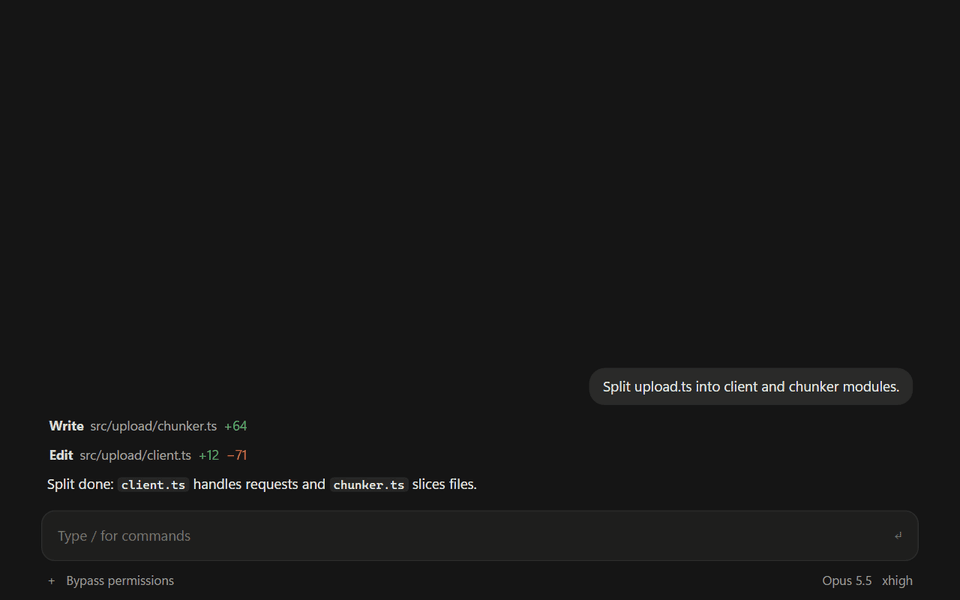
</p>

<h1 align="center">easy-compact</h1>

<p align="center">
  <b>See what every request costs. Know when to compact. Compact in one click — without losing your place.</b><br>
  Claude Code plugin · desktop app and terminal · Claude Code 2.1.295+
</p>

<p align="center">
  
  
  
  
</p>

<p align="center">
  <b>English</b> · <a href="README.ko.md">한국어</a>
  &nbsp;|&nbsp;
  <a href="#requirements">Requirements</a> · <a href="#install">Install</a> · <a href="#update">Update</a> · <a href="#whats-new-in-101">What's new</a> · <a href="#features">Features</a> · <a href="#hide-fold-bring-it-back">Hide · bring back</a> · <a href="#bar-not-showing">Bar not showing?</a> · <a href="#something-wrong--report-it">Report a problem</a>
</p>

---

## Requirements

| | |
|---|---|
| **Claude Code** | **2.1.295 or later.** Desktop app: in a Code tab session type `/status` and read the **Claude Code** row (not the app version in About). Terminal: `claude --version`. An older engine may not draw the bar at all; where easy-compact can still start, it shows a one-line update notice instead. |
| **To update** | Desktop app: **Claude → Check for Updates** (macOS) or **Help → Check for Updates** (Windows), then start a new session. Terminal: `claude update`. Homebrew's `claude-code` follows the slower stable channel and is still too old — use `brew install --cask claude-code@latest`. |
| **git** | Needed to add the marketplace from GitHub — `git --version` should print a version. macOS: if a developer-tools prompt opens, install them. Windows: [Git for Windows](https://git-scm.com/downloads/win). |
| **Where it shows** | The Claude desktop app (Code tab) and `claude` in a terminal. Not in the VS Code extension's chat panel, `claude -p`, cloud sessions or WSL sessions. |
| **Optional** | Node.js 14.8+ — draws the early part of very long sessions (records over 4 MB) that began before you installed, and counts today · this month (the pane's All sessions line and the bar option). |
| **Tested on** | Windows 11, desktop app and terminal. Nothing in the code is OS-specific, but macOS and Linux haven't been tried on real machines yet — reports welcome. |

## Install

**First time only.** The desktop app and the terminal share the same settings, so installing once works in both.

**Easiest — send this one line to Claude** (in the desktop app's Code tab or a terminal session):

```
Install this plugin: github.com/JaeSeongHa5280/easy-compact (claude plugin marketplace add JaeSeongHa5280/easy-compact, then claude plugin install easy-compact@easy-compact)
```

Then quit the Claude app completely and open it again (or start a new `claude` session). The Easy Compact bar appears above the input.

<details>
<summary><b>Type it yourself</b></summary>

**In Claude's input box — send each line on its own.** Send the second line after the first one finishes. Pasting both lines in one message doesn't install.

```
/plugin marketplace add JaeSeongHa5280/easy-compact
```

```
/plugin install easy-compact@easy-compact
```

- **Desktop app:** the first line opens **Add marketplace** — click **Sync**. The red warning there is the standard notice for any marketplace Anthropic doesn't run. The second line opens easy-compact in the plugin list — install it.
- **Terminal session:** the second line opens the plugin's details — choose **Install for you**.

**In a terminal (macOS Terminal · Windows PowerShell):**

```
claude plugin marketplace add JaeSeongHa5280/easy-compact
claude plugin install easy-compact@easy-compact
```

No `claude` command (usual if you only use the desktop app)? Send the one line above to Claude.

</details>

> **Note for Claude:** first check the engine is 2.1.295 or later (`<engine> --version`); if it is older, don't install — point the user to the update steps in [Requirements](#requirements). If `claude` is not on PATH (usual in the desktop app), run the running engine — its path is `CLAUDE_CODE_EXECPATH`, or else the executable of `CLAUDE_PID`. macOS · Linux: `"$CLAUDE_CODE_EXECPATH" plugin marketplace add JaeSeongHa5280/easy-compact`, then `"$CLAUDE_CODE_EXECPATH" plugin install easy-compact@easy-compact`. Windows PowerShell: `& $env:CLAUDE_CODE_EXECPATH plugin marketplace add JaeSeongHa5280/easy-compact`, then `& $env:CLAUDE_CODE_EXECPATH plugin install easy-compact@easy-compact` (without the variable, `(Get-Process -Id $env:CLAUDE_PID).Path`). If adding the marketplace fails because `git` is missing, help the user install git (on macOS, `xcode-select --install`). To update an existing install, run `plugin marketplace update easy-compact` first, then `plugin update easy-compact@easy-compact` (same engine path) — without the first step it reports the old version as the latest. Check `plugin list` shows `easy-compact@easy-compact` enabled, then ask the user to quit and reopen the app. Don't clone this repository or edit `settings.json`.

## Update

**From 0.5.0, inside the app:** the bar's **gauge** — the steps before **Compact** (a horizontal bar on 0.9.0, a ring on 0.8.x, **◔** on 0.6–0.7, **📊** on 0.5.x) → the version button at the pane's top right (on 0.6.x, the update row at the top of the **⚙ Settings** tab; on 0.5.x, the **easy-compact** section at the bottom of Settings) → **[Check for updates]** → **[Update]** if there is a new version → restart Claude. Only when you press it does Claude Code fetch the marketplace from GitHub. When a new version is already downloaded, the button reads *Update N* (*New N* up to 0.9.0; on 0.6.x, a *New version N* card at the top of **Overview** and a dot (•) on the Settings tab).

**On 0.4.1 or earlier, or to do it yourself, send this one line to Claude**, then restart Claude:

```
Update this plugin: easy-compact (claude plugin marketplace update easy-compact, then claude plugin update easy-compact@easy-compact)
```

To do it yourself in a shell, these two lines:

```
claude plugin marketplace update easy-compact
claude plugin update easy-compact@easy-compact
```

- Typing the install lines again only says *already installed*, and `plugin update` alone reports the old version as the latest — the first line fetches the new list.
- Your settings (compact range, chosen screen and so on) stay as they were. In 1.0, Today, This month and the limits became screen values; if yours differed from your preset, they move to **Custom** exactly as they looked. The 0.4.0 **Basic** screen is gone and becomes **Simple**.
- **Get new versions automatically:** in a terminal session, `/plugin` → **Marketplaces** → **easy-compact** → **Enable auto-update**. It is off for marketplaces Anthropic doesn't run ([Claude Code docs](https://code.claude.com/docs/en/plugins/install)).
- Your version: `claude plugin list`. What changed: [CHANGELOG](CHANGELOG.md) · [releases](https://github.com/JaeSeongHa5280/easy-compact/releases).

<details>
<summary><b>Remove</b></summary>

```
claude plugin uninstall easy-compact@easy-compact
```

No cloning into `~/.claude` and no `settings.json` edits are involved. Just want a break? [Turn the bar off](#hide-fold-bring-it-back) instead.

</details>

## What's new in 1.0.1

- **Fixed: "Compacting now would cost more" while overdue** — a moment when Claude Code briefly had no context size was counted as a compact, so the next request became the post-compact size (*Resident* 490k) and the bar called compacting a loss. Now it counts only if the next request is clearly smaller. Such records saved by 0.9.1 – 1.0.0 are dropped when read.
- **Easy Auto range in the Overview tab** — right below the compact range in the Compact timing card, the same value as Settings → **Compact**.

## What's new in 1.0.0

- **Easy Auto compact** — leave it on and, when the context passes a range you set, it saves → compacts by itself, and if a long task was running it picks the work back up. Turn it on or off per session with the switch at the top right of the bar's **[Compact]** popup — see [5. Easy Auto](#5-easy-auto--compacts-for-you).
- **Slim screen · screen presets** — [Slim | Simple | Detailed | Custom] at the top of Settings. Slim is one button below the input plus an alert line only when needed; Custom picks [Off | When needed | Always] for each row.
- **Running question strip** — while an answer runs, the question's cost and request count right above the input (a laptop bug, or agent characters while agents run).
- **The gauge is the side pane's door** — on every screen, press the gauge to open the pane and again to close it.
- **[Clear] asks once more, and the compact message is picked in the popup toolbar** — [Normal | Long-session handoff | Wrap-up | Write my own].
- **A flash when a value goes up · colors for Today and This month** — climbing to the next color flashes the text background three times (follows Settings **Animations**).
- **Cost fixes** — question totals cover the whole session, a forked session counts only its own share, and the size right after a compact is the first request after it.
- **When you update** — your settings carry over as they looked. Today, This month and the limits are screen values now; to change them on a set preset, switch to **Custom**.

Full list: [CHANGELOG](CHANGELOG.md).

<details>
<summary><b>What's new in 0.9.5</b></summary>

- **The steps gauge is easy to spot again** — at *Time to compact* every lit step is orange, and when *Overdue* all four steps are red and blink, as before 0.9.4. The 0.9.4 level meter left just one orange or red step, which was easy to miss. The step count (Room left 1–2 · Time to compact 3 · Overdue 4) and the far-end order while compacting stay. Steps and Vertical steps.

</details>

<details>
<summary><b>What's new in 0.9.4</b></summary>

- **The bar lines up** — on the Detailed screen, row 2 is the money so far (Session · Today · This month) and row 3 the values right now (Per request · Context · Compact range · Cache), then this question and **Compact**. On a wide bar the cells of all three rows start in the same columns; on a narrow one they wrap between cells as before.
- **Quieter numbers** — plan-limit percentages stay gray until 70% (orange) and 90% (red), *Context* colors only its number, and amounts get thousands separators ($2,636.86).
- **The steps gauge reads like a level meter** — each lit step has the color of its place (steps 1–2 white · 3 orange · 4 red), only the red step blinks when overdue, and while compacting the steps light up from the far end — emptying, not charging. Steps and Vertical steps; the other shapes are unchanged.
- **A tidier compact timing card** — *Compact now* and *Deferral cost* line up as name and value; the Detailed view drops the chosen-range line and the *Not advised* row (the table says the same); *★ Suggested* and **[Use this range]** sit on one line; the row of your current size gets a blue ●.
- **The Easy Compact mark in Cost per question** — the old 🗜 is now your gauge shape, drawn still in blue (desktop).
- **Fixed** — diagnostic lines in the conversation after a compact the hook didn't see; the input box flickering when the bar closes or reopens and around Claude Code's quick survey (desktop); the bar part name *Cache time left*; and one parameter name that kept 0.9.2 and 0.9.3 out of the Anthropic directory.

</details>

<details>
<summary><b>What's new in 0.9.3</b></summary>

- **Each request uses the rates of the Claude Code version that sent it** — Claude's usage page prices a request by the rate table of the Claude Code version that sent it, not by date. The Sonnet 5.5 cache-read cut ($0.20 → $0.10) applies from requests sent by Claude Code 2.1.299, so 0.9.2's fixed date (October 15) was off on machines that updated at another time — on the machine we compared, this month was $928.96 vs the usage page's $944.34, now about $944. The rate line at the bottom of the pane says *from Claude Code 2.1.299 · on this PC Oct 16*.

</details>

<details>
<summary><b>What's new in 0.9.2</b></summary>

- **Amounts match Claude's usage page** — the Sonnet 5.5 cache-read cut ($0.20 → $0.10) now counts from October 15, when the usage page applies it (the price list says October 7) — this month came out about $919 vs the usage page's $920 on the machine we compared, instead of $140 lower. The rate line at the bottom of the pane says so (by Claude Code version since 0.9.3).
- **Gauge shape "Vertical steps"**, and **a battery frame on both steps gauges** — four steps from the bottom (Settings **Bar** tab → **Gauge shape**); the steps gauge stays the default.
- **Older records use the rate of their day** — cost per question rebuilt from the session record, the context flow, compact savings and the other-model comparison use the rate in effect on each request's day.
- **Update check no longer gets stuck at "Checking…"** — pressing it several times runs one command; with no response it stops after 90 seconds with **[Try again]**; a leftover state clears when you press the version button again.
- **Cost by size key** — *Blue row = context now · border = the compact range you picked*.
- **Highlight is off at first** — turn it on in Settings **Answer chip** tab → **Highlight** (if you've saved settings before, your value stays).

</details>

<details>
<summary><b>What's new in 0.9.1</b></summary>

- **Show diagnostics before you share** — **Report a problem** in the pane's version drawer and in the Settings **General** tab: **[Show diagnostics]** first shows what's inside and the first lines. Your questions, answer endings, step names and custom texts are left out from the start; then **[Copy]**, **[Save as file]** or **[Open an issue ↗]** — exactly what you saw. See [Something wrong?](#something-wrong--report-it).
- **Settings previews look like previews** — a light well with a blue **Preview** chip instead of a border; the whole-bar preview sits above a mock input. The preview shows the gauge in your shape, with a four-step sample under **Gauge shape**. Bar size one line · keep folded · line below the input show in the preview too.
- **The gauge moves while compacting** — progress blue, per shape (bars breathe · the ring spins an arc · steps light in turn), then shrinks from blue to the new size.
- **Steps gauge by default** — the horizontal bar looked like the plan-limit bars next to it (a shape you picked stays).
- **The version button is always there** — *Update 0.9.1* when a new version is out.
- **No more pre-compact size after a compact** — a compact Claude Code didn't announce (one from the bar button, for one) went unrecorded: the bar kept the old size and the pane said *0 compacts* until the next request. Now it is recorded within 1.5 seconds.
- **Sonnet 5.5 cache reads** — the October 7 price cut ($0.20 → $0.10) is counted by date.

</details>

<details>
<summary><b>What's new in 0.9.0</b></summary>

- **The gauge is a horizontal bar by default** — the ring looked exactly like the app's own context ring next to the input. **Gauge shape** in the Settings **Bar** tab offers **Bar** · **Ring** · **Vertical bar** · **Steps** (the bar, the pane header and the compact card change together).
- **Compact card: Easy Compact · Clear · Cancel** — *Save & compact* is now **Easy Compact**, and **Clear** (/clear) takes the place of *Compact now*. With a cold cache the card skips the save question: **Plain compact** (Claude's /compact — it shows the text it adds) · **Clear** · **Cancel**.
- **Settings in tabs** — under the screen type at the top: **Bar · Answer chip · Pane · Compact · General**. The Bar tab has a card each for **Whole bar · Limits row · Cost row · Question row**, each previewing only its own row.
- **The folded-bar button is one colored square** — **🟦 Easy Compact** below the input; the square follows the size step (🟦 room · 🟧 time to compact · 🟥 late). In a terminal a folded bar leaves one **[⇱ Easy Compact]** line in its place (ctrl+x tab → Enter).
- **A line below the input** (optional) — while the app's end-of-turn "next step" box takes the bar away, the gist of the bar stays below the input.
- **Overview** — the bars breathe while compacting and shrink when it ends, the compact timing bar fills from the left, Cost by size marks the row you are in, and **Context numbers** (size · % · both) reach the compact card.
- **Diagnostics · reporting** — **[Diagnose]** in the pane's version drawer saves this session's state to one file ([Show diagnostics] from 0.9.1). The `/easy-compact` command is gone (the bar's ✕ and the folded-bar button do the same).

</details>

<details>
<summary><b>What's new in 0.8.0</b></summary>

- **The gauge opens the pane** — click the ring before **Compact** to open or close the Easy Compact pane, like the app's own context ring. The **◔** button is gone, so the bar's top right holds only **—** and **✕**. Hover the gauge for the context and your compact range, the **Compact** button for what to do.
- **Terminal: buttons instead of dropdowns** — value lists are buttons in a row (a dropdown kept the arrow keys), session-cost colors are **[ − ] $10 [ + ]**, and the compact card is numbered: **1** Save & compact · **2** Compact now · **3** Cancel — typing the number in an empty prompt presses it.
- **Today · this month include what isn't in the records** — compact summaries and Claude Code's own background requests, as easy-compact measured them.
- **? chips** — the **?** beside a setting is a small bordered chip right after its name.
- **Fixed** — the gauge blinking when the bar changed size, and *Compact now* not responding to Enter in a terminal.

</details>

<details>
<summary><b>What's new in 0.7.0</b></summary>

- **Version button** — at the right of the pane's tab row: *New N* when a new version is out, *What's new in N* after updating. Press it for what changed in every newer version, plus **[Check for updates]** and **[Update]** — you can check again any time, even right after updating.
- **Settings fold like the app's side panel** — **⌄** / **›** beside each section title; only **Screen** is open at first, and a folded section shows its current value. **Screen** keeps what the screen type decides; the rest of the bar's options moved to **Bar — every screen**.
- **Context as size, % or both** — on the bar and the gauge chip (**Context numbers**). Hovering the gauge or the compact button shows the compact range too.
- **Agent character** — on the desktop a small pixel bug takes the 🤖's place: it walks while that agent runs and stands still when it's done (**Animations** switch).
- **The cache lifetime is shown, not changed** — easy-compact no longer writes `promptCacheTtl` to your Claude Code settings.
- **Fixed** — the bar's session cost starting over from $0 after an app restart, the compact button's chip covering ◔, *downloaded — restart to apply* staying after an update, the **?** in Overview's Compact card not opening, and Korean left on the English screen.

</details>

<details>
<summary><b>What's new in 0.6.0</b></summary>

*0.6.1 fixes the bar showing the pre-compact size and **Compact overdue** from the end of a compact until the next request — it now shows the size after the compact, marked *just compacted*.*

- **Context gauge** — the icon in front of the bar's compact button is a ring gauge like the app's own context ring (desktop). How full it is shows the context; orange means *Time to compact*, red *Compact overdue* — it pulses when overdue and pressable, and drains when a compact finishes (turn the motion off in Settings → Screen → **Motion**).
- **Compact timing lives in Overview** — the Simple view has the range dropdown in the *This session* card with a verdict-and-cost line under it; the Detailed view has a colored **Cost by size** table in the Compact card (the picked range is outlined). Picking applies at once, and **Enter a size…** at the end of the dropdown sets a single size.
- **Settings look like the app's settings** — one *name …… control* row each, the explanation behind the **?** next to the name, blue switches for on/off (dimmed when locked), dropdowns for value lists. The update row moved to the top.
- **Two compact texts** — write **① Text sent before compacting** and **② Text after /compact** separately. The dropdown (Normal · Long-session handoff · Wrap-up) fills both.
- **Pane name "Easy Compact" · first tab "Overview"** — the bar's pane button is **◔**. Overview's [Simple|Detailed] remembers your pick. Folding is the small **▾ ▸** chip in front of each title.
- **Question costs survive a restart** · **stopped questions keep their row** (*⏹ stopped*) · **a new-version card** (top of Overview, no network) · **choose the cost order** · **usage-limit bars in the app's colors**.
- **Fixed** — this month's amount came out low (subagent output was undercounted), the bar said *overdue* while the confirm card said *loss*, and wrapped lines started with "·".

</details>

<details>
<summary><b>What's new in 0.5.1</b></summary>

- **"All sessions" at the top of the usage pane** — `All sessions  Today ~$65 · This month ~$788` (every session on this PC, API list prices), right above **This session · Total $**. The Detailed view always shows it, whatever the option says; the Simple view shows only what you turned on.
- **Settings row "All sessions"** — All screens → *All usage* is now **All sessions**. When on, today · this month also show on the bar and in the Simple pane.
- **Korean UI** — the bar's first label is now **세션** (Session), like the English one; the pane's first card keeps **이 세션** (This session).

A 17-second tour is on the [v0.5.1 release page](https://github.com/JaeSeongHa5280/easy-compact/releases/tag/v0.5.1).

</details>

<details>
<summary><b>What's new in 0.5.0</b></summary>

- **Fits the pane and the window** — cards fill the pane and bars and graphs grow to the card width. When space runs out nothing breaks mid-word; the least important cells go first (the bar and the settings cost table).
- **One set of icons, one meaning per color** — line icons replace the glyphs on card titles, the bar and the confirm cards (desktop). Progress is blue, caution a single yellow, loss · overdue · cache expired red, ★ optimum green.
- **Today · this month** (option, off by default) — Settings → Screen → Details → All screens → **All usage** (**All sessions** from 0.5.1). When on, the bar shows `Today ~$65 · This month ~$788` (every session on this PC, API list prices).
- **Update from inside the app** — **[Check for updates]** → **[Update]** at the bottom of the Settings tab. A downloaded new version puts a dot on the Settings tab, and the first start after updating opens the pane with *Updated to 0.5.0 · What changed ▸*.
- **"Now" in the simple view is one decision line** — state + one number + what to do. Names are tidied too: bar size **Full · One line**, first card **This session**.
- **Fixed** — a finished question's cost changed when you sent the next one (the app's own requests after an answer now count for 30 seconds only).

A 33-second tour is on the [v0.5.0 release page](https://github.com/JaeSeongHa5280/easy-compact/releases/tag/v0.5.0).

</details>

<details>
<summary><b>What's new in 0.4.1</b></summary>

- **Three screens — Simple · Detailed · Custom.** **Simple** is for newcomers and anyone for whom tokens and caching are unfamiliar: a one-line bar (session cost · context · cache · Easy Compact) and only the essentials in the pane and Settings. **Detailed** is for people who know how AI costs work: plan limits, per request, compact range, the question row, graphs and the full cost table. **Custom** lets you pick the bar's parts and the **Detail level** (Minimal · Everything). New installs and updates start on Simple.
- **A preview in Settings → Screen** — see how the bar and the question-cost chip after each answer will look as you choose.
- **The question cost after each answer is a blue chip** — `🧾 This question $0.61 · 6 requests · 🤖 1 agent $0.24 included`. On the Detailed screen, **▸ Details** opens it in place: main · 🤖 agents · 🗜 compact · ⚙ app's own requests, and the priciest main steps.
- **Question highlight** — hover the question-cost chip or its row in the Usage pane and the answer it priced turns gray with them (desktop, off at first — turn it on in Settings).
- **For all screens: the limits row and session-cost colors** — under Screen → Details, changeable on any screen. If a session has finished a request and still has no plan limits, the limits row option is left out.
- **Cache shows as `cache expires in 42m`** — easier to read than `42/60m`.
- **No compacting at a loss** — when the cache is cold and continuing is cheaper, or there is little to save, the Easy Compact card shows *Keep working* and no compact buttons. easy-compact makes the money call with numbers; the session asked to save only checks whether it would lose information (it used to go ahead with a losing compact because "everything is saved to memory").
- **Clearer cost per question** — the simple view shows `N requests · 🤖 N agents` per question; the detailed view says `1 agent $3.56 included` and opens into main and agent parts.
- **`Question (10 req assumed)` in the cost table** — one question is fixed at 10 requests so the figure doesn't swing, with this session's average request count and its range in color below.
- **Simple · Detailed** at the top of the pane is a quick look — closing the pane or visiting Settings returns to your detail level. Opened Settings sections also reset when the pane closes (Screen and its Details open).
- **Ready for macOS** — "Windows" is gone from the descriptions and [Requirements](#requirements) lists what you need. On an engine older than 2.1.295 (Homebrew's stable channel, for one) it shows a one-line update notice where it can start, and when `node` is missing for a long record it says so.
- Removed: the question-average part, the separate "🤖 under answers" option (it follows the screen) and the 0.4.0 **Basic** screen (now Simple).

A 35-second tour of these is on the [v0.4.1 release page](https://github.com/JaeSeongHa5280/easy-compact/releases/tag/v0.4.1).

</details>

## Why

Claude Code re-reads the whole context on every request — a session at 300k pays for 300k on every step, and nothing on screen tells you.

| Without | With easy-compact |
|---|---|
| Typing `/context` again and again | Context and cost **always on screen** |
| *"What did that cost?"* | Cost per **request, question and step** |
| *"Compact now or later?"* | A gauge — 🟠 **Time to compact** · 🔴 **Overdue** · dim = not yet |
| *"Where were we?"* after a compact | **Next steps kept** in the summary |
| A long task left running stalls at a compact | **Easy Auto** saves → compacts → carries on by itself |

## Demo · 60 s

https://github.com/user-attachments/assets/e1364a29-d278-429e-9be9-c9ac30af9b5f

## Features

### 1. Live cost, right above the input

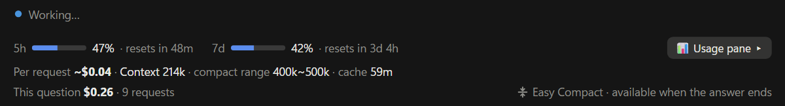

**Context, next-request cost and the last question's cost — updated after every request.**
Also on the bar: this session's cost so far (yellow · orange · red at $10 · $50 · $100 — change them in Settings), your 5-hour and 7-day plan usage, minutes left on the prompt cache (`cache expires in 42m`, or `Cache 42m left` when the cells line up), the context gauge (click it for the Easy Compact pane) and the **Compact** button, and the window buttons (top right). What shows is set by the **Screen preset** at the top of Settings — **Slim** (once you know your way around · alerts only when needed), **Simple** (for starting out · essentials only — the default, one line), **Detailed** (everything — three rows) and **Custom** (pick each part). The **Detailed** bar has three rows — plan usage, the money so far (Session · Today · This month), and the values right now (Per request · Context · Compact range · Cache) with the last question; on a wide bar the cells line up in columns. The question that's running shows separately in the **Running question strip** right above the input ([2](#2-cost-per-question-step-by-step)). When a value climbs to the next color, its text background flashes three times. On **Custom**, the Settings **Bar** tab picks the bar layout (Button below · One row · Three rows) and [Off | When needed | Always] for each row of **Shown at the input** — *When needed* appears only when it needs attention, and on a set preset the same rows show dimmed. Color thresholds for Session · Today · This month, **Cost order** and **Context numbers** (size, % or both) are in the **Numbers · colors** card; the gauge's look is **Gauge shape** in the **Bar** card (Steps (default) · Bar · Ring · Vertical bar · Vertical steps). Still too much? Shrink the bar to one line or fold it — see [Hide, fold, bring it back](#hide-fold-bring-it-back). Subagent spending shows up as `1 agent $X included`.

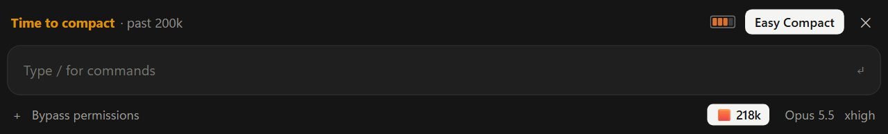

**The Slim screen — normally just one button below the input (🟦 120k), and one alert line above the input only at Time to compact, when Overdue, or when a cold cache makes a plain compact cheaper.** Press the button for a one-line summary; that line's gauge opens the pane. The ✕ on the alert line closes it until things get more urgent.

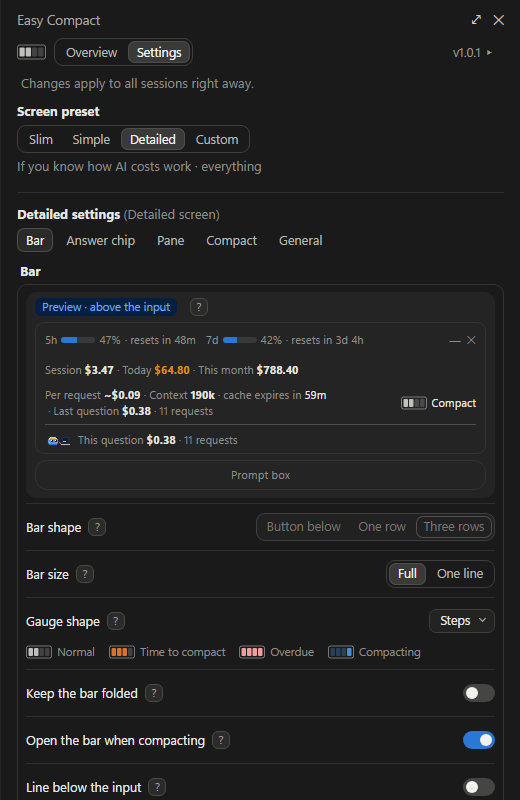

**Settings: the screen preset at the top (Slim · Simple · Detailed · Custom), then below a divider the detailed settings for the chosen screen — tabs Bar · Answer chip · Pane · Compact · General.** The Bar tab has the **Bar** card (a preview drawn with this session's values · bar layout · bar size · gauge shape · keep folded · line below the input), **Shown at the input** (Off · When needed · Always for each part) and **Numbers · colors**. The preset sets the bar's parts, Overview's first view and whether the chip under each answer shows details (**Answer chip details**), and the values it decides show dimmed. **Custom** lets you pick each one, and **Start from** begins it from a preset's values.

### 2. Cost per question, step by step

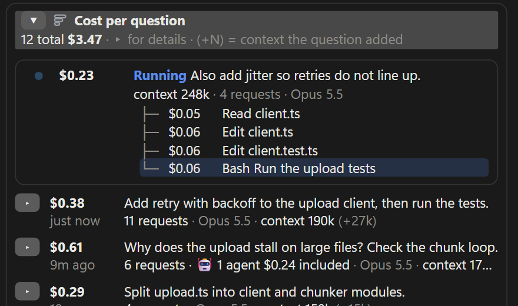

**While Claude works, every step gets its own line and price.** Tool names are colored by kind, and app tools get plain names (update_plan → *Task list* and so on). The **Running question strip** right above the input shows the question's cost and request count on one line too — a laptop bug works away, and while agents run a lead bug waves and small bugs follow (up to three, then *+N*) until it reads *N agents done*. When the answer ends the strip goes and the answer chip takes over (Off · Always in the Settings **Answer chip** tab).

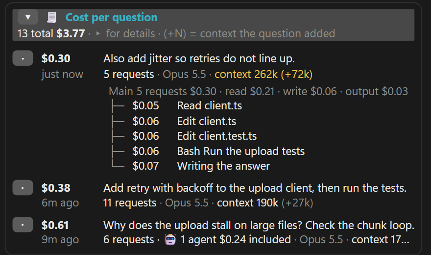

**Open any finished question** (detailed view): main (read / write / output) · 🤖 agents · 🗜 compact · ⚙ app's own requests, then each step (newest on top; the rest fold into *N earlier steps* at the bottom). If a step's text is cut off, **[Full text ▾]** opens all of that question's step text. `(+42k)` is how much context that question added. The simple view doesn't open questions — each shows its total and `N requests · 🤖 N agents`. Question costs survive restarting the app and reopening older sessions, and a question you stop mid-answer stays as *⏹ stopped*. The question log keeps 60, but totals cover the whole session (questions pushed out are counted separately — requests in the total that no question caught show as *Outside questions $X*). A forked session counts only its own share after the fork.

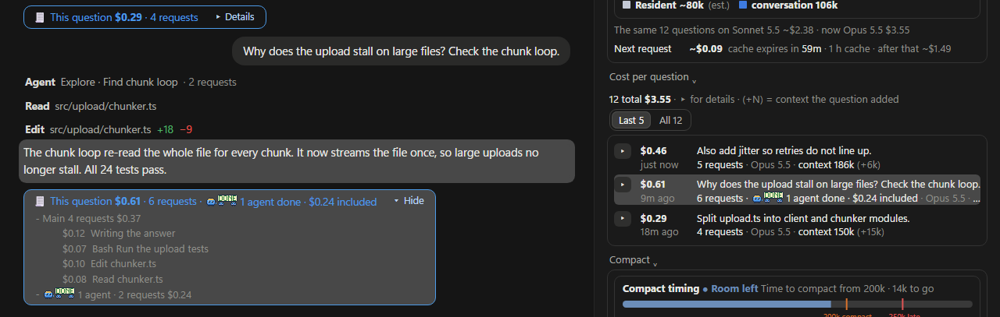

**Every answer ends with a blue chip: what that question cost.** On the Detailed screen, **▸ Details** opens it in place — main · 🤖 agents · 🗜 compact · ⚙ app's own requests, with the priciest main steps. **Hover** the chip or the question's row in the pane and the answer, the chip and the row turn gray together (desktop, with Settings **Answer chip** tab → **Highlight** on — off at first).

### 3. Know when to compact

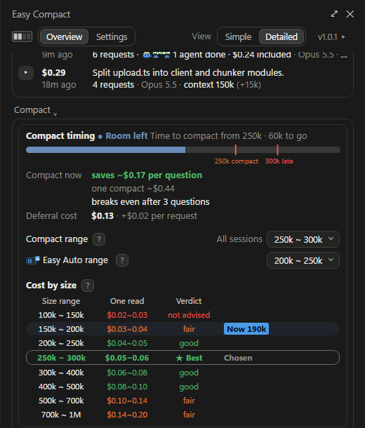

**Pick a compact range in the Overview tab.** The Simple view has the range dropdown in the *This session* card, with one line under it: the verdict (★ Best · good · fair · not advised) and the cost of one read, one question and a cold cache. The Detailed view adds the suggested range (★, with **[Use this range]**) and the **Cost by size** table in the Compact card — one read and one question per size (10 requests assumed × the current model's rates); a wider pane adds the cold-cache cost and how far each size is from the cheapest (★) — a narrow one drops the least important columns first. Cell colors are the verdicts (the table's **?** says which ranges are not advised), and the last column tags rows with *Now 73%* (the row your size is in, on blue) · *Chosen* · *Auto* (the Easy Auto range) — all of them when they land on one row. Picking applies to all sessions at once, and **Enter a size…** at the end of the dropdown sets a single size by number. Right below it is the **Easy Auto range** dropdown (from 1.0.1 — the same value as in Settings).

| Gauge and button | Means |
|---|---|
| Dim gauge · plain **Compact** | Not now — before your range, right after a compact, or compacting would cost more. Hover for the reason |
| 🟠 Orange gauge · *Time to compact* | Inside your range |
| 🔴 Red gauge (pulsing) · *Compact overdue* | Past your range — the deeper, the faster it pulses |
| 🔴 *Cache expired* · **Plain compact advised** | The cache went cold, and compacting now is cheaper than re-sending everything |

Hover the gauge for the context and your compact range (as size, % or both — **Context numbers**); click it to open the Easy Compact pane. Hover the button for the state and what to do. The gauge starts as steps — **Gauge shape** in the Settings **Bar** tab switches it to a horizontal bar, a ring (like the app's context ring), a vertical bar or vertical steps. Steps and Vertical steps sit in a battery frame: the stage sets how many steps are lit (Room left 1–2 · Time to compact 3 · Overdue 4) and they all take its color — orange at Time to compact, red and pulsing when Overdue. Colors, pulsing and the post-compact shrink mean the same in every shape; while compacting or saving it moves in progress blue (bars breathe · the ring spins an arc · steps light up from the far end).

### 4. Easy Compact — one click

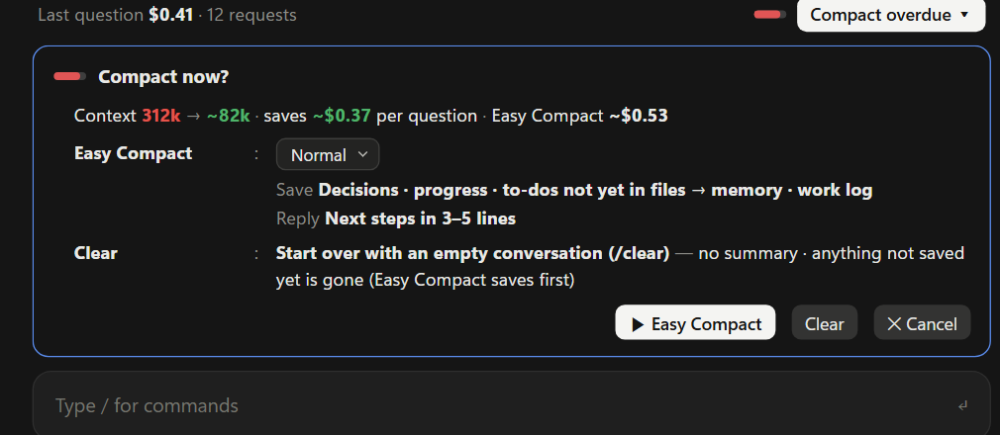

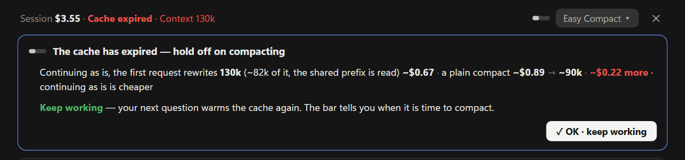

**"Compact now?" shows what you save per question and what the compact costs.** Its toolbar [Normal | Long-session handoff | Wrap-up | Write my own] picks what to keep, and what the chosen text does is shown in two lines (*Save* · *Reply*) — with **Write my own**, type into the two boxes right there (**①** text sent before compacting · **②** text after /compact) and it saves with that. The buttons are **▶ Easy Compact** · **Clear** · **✕ Cancel**. **Clear** (/clear — start over with an empty conversation, no summary) doesn't clear right away: the same spot asks *Clear the conversation?* with how many questions and how much context Claude forgets, and **[← Back]** · **[Clear]**. The **Easy Auto** switch at the card's top right is in [5. Easy Auto](#5-easy-auto--compacts-for-you). With a cold cache it's the *Cache expired* card — continuing vs a plain compact, with no save question: **▶ Plain compact** (Claude's /compact, showing the text it adds) · **Clear** · **✕ Cancel** (a save question would first re-send everything). **When compacting now would cost more** (a cold cache where continuing is cheaper, or little to save), the card has no compact buttons, just *Keep working* — easy-compact decides the money side with numbers and doesn't leave it to the session. In a terminal the card's buttons are numbered — **1** Easy (Plain) compact · **2** Clear · **3** Cancel · **4** Easy Auto on / off (not on the cold-cache card) — and typing the number in an empty prompt presses it (while it asks about Clear: **1** Clear · **2** Back). Pressing **Easy Compact**:

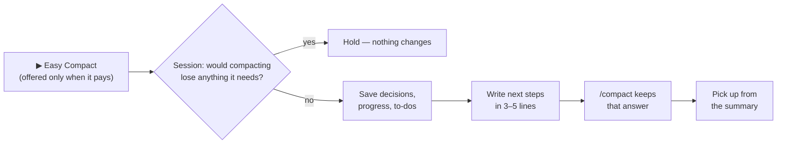

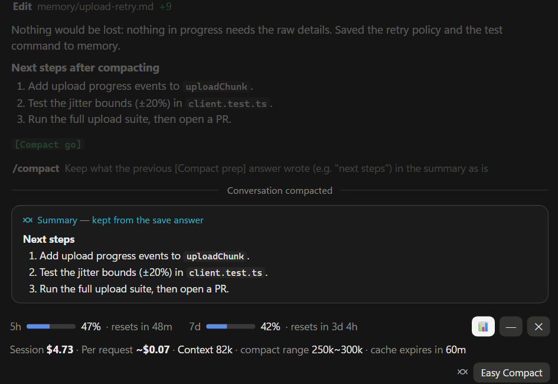

**After the compact, the next steps are in the summary — and every request costs less.** **Plain compact** skips the save step, and **Clear** empties the conversation without a summary. While compacting, the Overview's context and compact timing bars breathe slowly (*Compacting…*), then shrink from the old size to the new one.

### 5. Easy Auto — compacts for you

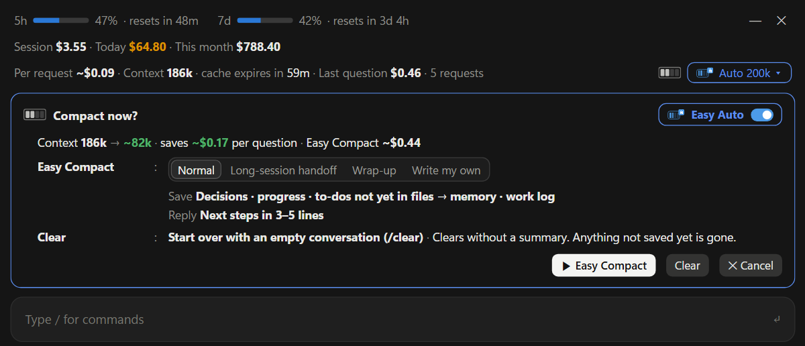

**Leave it on and a long task won't stall at a compact.** Turn it on with the **Easy Auto** switch at the top right of the card the bar's **[Compact]** opens (per session — new sessions start with the value you last picked yourself; in a terminal it's **4** on the card). While it's on, the bar's compact button becomes a blue *Auto 200k* chip, and with the bar folded or on Slim the line below the input shows *🔄 Auto 200k* (press it for that card). The range is **Easy Auto range**, right below the compact range — in the Settings **Compact** tab and in the Overview tab's Compact timing card (it starts at your compact range and is shared by all sessions).

| When | What it does |
|---|---|
| An answer ends past the front of the range | Waits a moment; if you haven't typed, saves → compacts |
| A long task runs past the back of the range | Stops that turn, saves → compacts → picks the work back up |
| Compacting doesn't bring it below the range, or it passes again within 3 requests | *Auto stopped* with a one-line note (**[Turn on again]**) |
| The cache expires or the model changes | Turns Easy Auto off in that session with a one-line note (new sessions use the value you picked) |
| Compacting now would cost more (cold cache · little to save) | Skips that one time |

While it runs, the bar and the strip show the current step (*Easy Auto · saving → then compact* · *Easy Auto compact in progress…*). Typing doesn't turn it off — if the save answer doesn't end with *[Compact go]* (you typed in between, or there was something to lose), it doesn't compact that time, and if you typed after the compact it doesn't send the pick-up message. While it's on, a folded bar doesn't open by itself when it's time to compact (Easy Auto handles the alert). What Easy Auto sends starts with *[Easy Auto · summary]* · *[Easy Auto · continue]*, stays in the conversation, and those requests cost tokens.

### 6. The Easy Compact pane

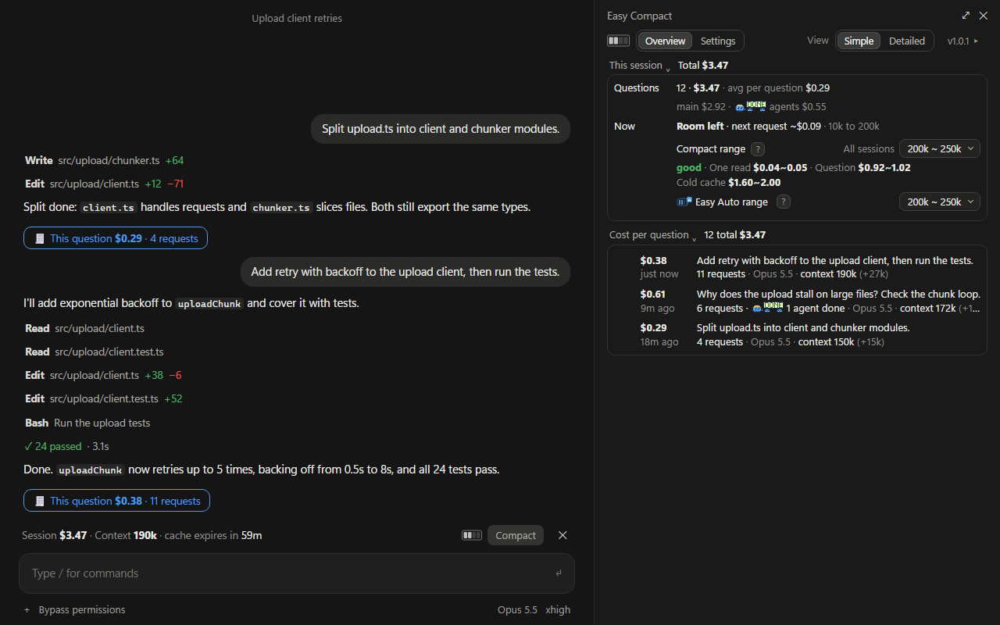

Open it by clicking the bar's **gauge** (in a terminal, **[Pane ▸]**). The first tab is **Overview** — **Simple** (the Simple screen's first view): **This session** — running total, questions, main / 🤖 / ⚙, one *now* line (state · one number · what to do) and the compact range dropdown — plus cost per question. **Detailed** (the Detailed screen's first view): also what another model would have cost, the context bar, compact timing (suggested range · cost by size), context flow and what each compact saved. The Detailed pane starts with an **All sessions** line (today · this month for every session on this PC) whatever the option says; the Simple pane shows only what you turned on. **View [Simple][Detailed]** at the right of the tab row switches the view and remembers it (changing the screen preset in Settings resets it to that screen's view). Cost per question starts folded. By default it opens and closes together across your open desktop sessions, and doesn't open by itself in new sessions — both are in the Settings **Pane** tab. In the Detailed view, **Cost by size** tags rows in its last column with *Now 73%* · *Chosen* · *Auto*.

### 7. Terminal too

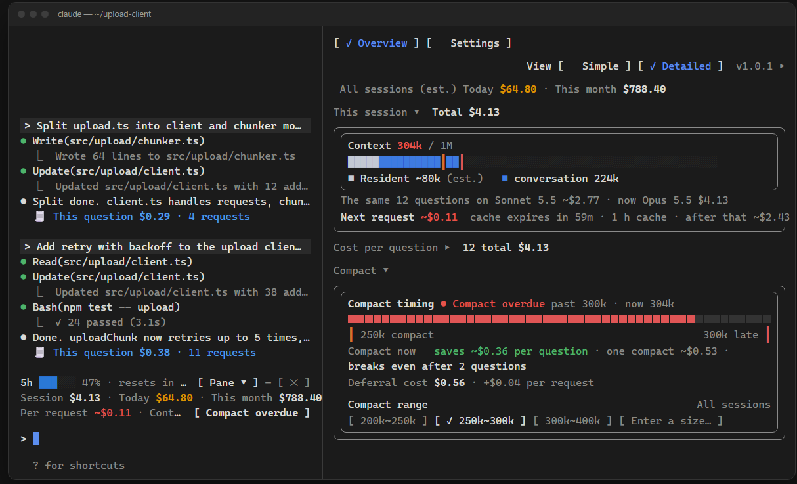

**The same bar and pane in the CLI.** To press the bar's buttons, press ctrl+x tab to move into the bar (or click, in fullscreen mode). A folded bar leaves one **[⇱ Easy Compact]** line in its place — reach it the same way and press Enter to open the bar again. Slim is one line in the bar's place (**[120k]** — press it for the pane, plus the compact button when it's time), and Easy Auto turns on and off with **4** on the compact card.

## Hide, fold, bring it back

The window buttons sit at the top right of the bar. Every choice applies to all sessions and stays after a restart.

| Button | What it does | How it comes back |
|---|---|---|
| **—** / **□** | One line / full | Press it again |
| **✕** fold | Folds the bar below the input in every session | By itself when it's time to compact (orange · cache expired) — or press **🟦 140k** below the input (the square shows the current size step: 🟦 room · 🟧 time to compact · 🟥 late; the number is the context now). In a terminal, the **[⇱ Easy Compact]** line in the bar's place (ctrl+x tab → Enter) |
| **Gauge** (the steps before **Compact**) | Opens or closes the Easy Compact pane (in a terminal, **[Pane ▸]**) | Press it again |

Whether a folded bar opens by itself is **Open the bar when compacting** in the Settings **Bar** tab (on by default). Turn it off and the bar stays folded — the folded-bar button turns grey (*closed*) — until you press it: a pause before you decide to uninstall. Folding an opened-by-itself bar again keeps it folded until things get more urgent (red · cache expired). The **Slim** screen is always folded — press the button below the input for a one-line summary (▴); the ✕ on the alert line above closes it until things get more urgent.

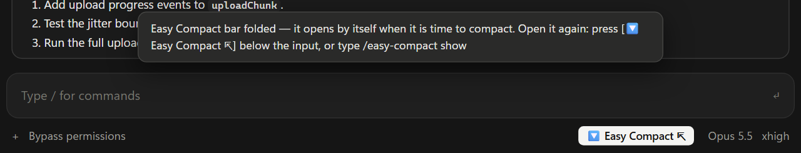

**There are no slash commands** (from 0.9.0) — everything is on the bar's buttons and the **⚙ Settings** tab of the pane. Settings has the **Screen preset** (Slim · Simple · Detailed · Custom) at the top, then the detailed settings tabs: **Bar** (Bar — preview · bar layout · bar size · gauge shape · keep the bar folded · open the bar when compacting · line below the input / Shown at the input — Off · When needed · Always for each part · All sessions / Numbers · colors — session, today and this-month colors · cost order · context numbers as size, % or both), **Answer chip** (answer chip · running question strip · answer chip details · highlight), **Pane** (open the pane in new sessions · open and close together), **Compact** (when to compact · Easy Auto range · cache), **General** (animations · report a problem · language). The parts the preset decides are changed on Custom and dimmed on the presets. Each row's explanation shows when you hover the **?** next to its name — press it to keep it open (in the terminal, press [ ? ]). In a terminal, value lists are buttons in a row instead of dropdowns. Compact timing is picked in the Overview tab. The button at the pane's top right shows the version (*dev* for a folder-loaded copy): press it for what changed in each version, **Check for updates**, **Update** and **Report a problem**. The cache lifetime is only shown — Claude Code sets it (`promptCacheTtl` in your settings, or an environment variable), and easy-compact never edits your settings.

**Buttons cost nothing** — they leave nothing in the conversation. Only Easy Compact's save question · /compact and what [Easy Auto](#5-easy-auto--compacts-for-you) sends in a session where it's on cost tokens.

**While the end-of-turn "next step" box is up, the bar steps aside.** When Claude ends a turn asking what to do next with buttons, the app takes plugin bars away until the box goes (that is the app; a plugin can't stop it — close the box and the bar comes back). Turn on **Line below the input** in the Settings **Bar** tab to keep the gist of the bar below the input meanwhile, e.g. *🟦 Easy Compact · Context 140k · compact range 200k~250k · Session $8.40*.

## Bar not showing?

1. **Version** — easy-compact needs 2.1.295 or later. An older engine shows a one-line update notice where it can, or nothing at all — check and update the version as in [Requirements](#requirements).
2. **Installed?** — in a terminal, `claude plugin list` should show `easy-compact@easy-compact` enabled. If adding the marketplace failed, `git` is usually missing.
3. **Restart** — quit the desktop app completely (not just the window), open it and start a new session. In a terminal, start a new `claude` session.
4. **Managed work machines** — if an administrator has blocked plugins or mods, it won't show.
5. **The end-of-turn "next step" box** — the app takes the bar away while it is up (close it and the bar comes back). [Line below the input](#hide-fold-bring-it-back) keeps the gist meanwhile.

Still stuck? See [Something wrong?](#something-wrong--report-it) below.

## Something wrong? — report it

1. **Show diagnostics** — the Easy Compact pane (the bar's gauge; in a terminal, **[Pane ▸]**) → the version button at the right of the tab row (`v1.0.0 ▸`) → **[Show diagnostics]** under **Report a problem** in the drawer (also in the Settings **General** tab). You see what's inside and the first lines — your questions, answer endings, step names and custom texts are left out from the start (turn the switch off to include them; your own text going out then shows in yellow). Then **[Copy]** (clipboard) or **[Save as file]** (the path shows in the card and a notice — nothing goes into the conversation), exactly what you saw. **[Open an issue ↗]** opens a new issue.
2. **What's in it** — every setting, the pane's state (open tab, open cards), usage numbers · the running question · compact phase, the question history (question text · cost per question · the end of each answer), the cost cross-check (the engine's total · what easy-compact measured), and counts of unpaired surrogates and control characters (candidates for a pane that doesn't draw at all).
3. **Where** — `~/.claude/plugins/data/easy-compact-easy-compact/debug-<session id>.json` (`plugins/data/easy-compact-synced/` if you installed from Anthropic's directory). The same session overwrites it.
4. **It stays on your computer** — easy-compact never sends it. Attach it yourself; it contains your questions and costs, so look it over and remove anything private before you post it.
5. **Open an [issue](https://github.com/JaeSeongHa5280/easy-compact/issues) with** — what happened, how to reproduce it, which screen (desktop app / terminal), the version (the version button · Claude Code's from `/status`), your OS, and the diagnostics file.

## Good to know

- **Amounts are API list-price estimates.** On a subscription they show how heavy a session is, not what you are billed.
- **Everything stays on your machine.** easy-compact reads your local session records and never goes online by itself. Only when you press **[Check for updates]** · **[Update]** under the pane's version button does Claude Code (the `claude plugin` commands) fetch the marketplace from GitHub.
- **Platforms:** built and tested on Windows 11. Nothing in the code is OS-specific, but macOS and Linux haven't been tried on real machines yet — reports welcome.
- **Desktop app:** right after the pane opens, the first click inside it only moves focus — click once more.
- Records over 4 MB are read with Node.js (14.8+). Without `node`, a very long session is drawn from when you installed, and the pane says so. Today · this month are counted with Node.js too — without it those bar cells don't appear and the pane's **All sessions** line says *Not measured* and why. Other sessions' transcripts (token counts only) are read only while that option is on or the pane's Overview tab is open in the Detailed view. Today · this month are cut at UTC midnight. They include what easy-compact measured for requests that aren't in the session records — compact summaries and Claude Code's own background requests (earlier days come from the cost-per-question history). Use on other computers and on the web isn't counted.

## License

[MIT](LICENSE)
