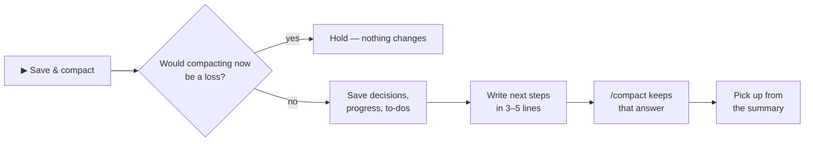

<p align="center">
  
</p>

<h1 align="center">easy-compact</h1>

<p align="center">
  <b>See what every request costs. Know when to compact. Compact in one click — without losing your place.</b>
</p>

<p align="center">
  
  
  
</p>

<p align="center">
  <b>English</b> · <a href="README.ko.md">한국어</a>
  &nbsp;|&nbsp;
  <a href="#install">Install</a> · <a href="#features">Features</a> · <a href="#commands">Commands</a>
</p>

---

## Install

Paste this into Claude Code — the copy button is at the right of the box:

```
/plugin install easy-compact --marketplace JaeSeongHa5280/easy-compact
```

Then quit the Claude app completely and open it again (or start a new `claude` session). The band appears above the input.
Needs Claude Code **2.1.295 or later**.

<details>
<summary><b>From a terminal, or asking Claude to install it</b></summary>

The same install as one terminal command — Claude can run this for you:

```
claude plugin install easy-compact --marketplace JaeSeongHa5280/easy-compact --scope user
```

1. If `claude --version` is older than 2.1.295, run `claude update` first.
2. Check with `claude plugin list` — `easy-compact@easy-compact` should say **enabled**.
3. Restart the Claude app (or open a new `claude` session).

That is all — no cloning into `~/.claude` and no `settings.json` edits.
To remove it: `claude plugin uninstall easy-compact@easy-compact` (or `/plugin uninstall easy-compact@easy-compact`).

</details>

## Why

Claude Code re-reads the whole context on every request — a session at 300k pays for 300k on every step, and nothing on screen tells you.

| Without | With easy-compact |
|---|---|
| Typing `/context` again and again | Context and cost **always on screen** |
| *"What did that cost?"* | Cost per **request, question and step** |
| *"Compact now or later?"* | 🟡 **Good time** · 🔴 **Overdue** |
| *"Where were we?"* after a compact | **Next steps kept** in the summary |

## Demo · 45 s

https://github.com/user-attachments/assets/cd8fd962-4361-4056-9372-fa321d3dda42

## Features

### 1. Live cost, right above the input


**Context, next-request cost and this question's cost — updated after every request.**
Also on the band: your 5-hour and 7-day plan usage, minutes left on the prompt cache, and the **Easy Compact** button.

### 2. Cost per question, step by step


**While Claude works, every step gets its own line and price.**


**Open any finished question:** read / write / output, then each step. `(+42k)` is how much context that question added.

### 3. Know when to compact


**Pick a compact range from a cost table.** Each size shows the per-request cost, the cost when the cache has gone cold, and how far it is from the cheapest size (★). Inside your range the band turns 🟡 *Good time to compact*; past it, 🔴 *Compact overdue*.

### 4. Save & compact — one click


**"Compact now?" shows what you save per question and what the compact costs.** Then:




**After the compact, the next steps are in the summary — and every request costs less.** *Compact now* skips the save step.

### 5. Terminal too


**The same band and Usage pane in the CLI.** Open the pane with `/easy-compact usage`.

## Commands

Everything is also a button in the band or the pane.

<details>
<summary><b>All commands</b></summary>

| Command | What it does |
|---|---|
| `/easy-compact usage` | Open or close the Usage pane |
| `/easy-compact settings` | Open the Settings tab |
| `/easy-compact set range <start> <end>` | Compact range, e.g. `set range 250k 300k` |
| `/easy-compact set compact <size>` | A fixed compact size (100k–1M) |
| `/easy-compact set compact range` | Back to range mode |
| `/easy-compact set cache <minutes>` | Warn when this much cache time is left |
| `/easy-compact prompt <Normal \| Long-session handoff \| Wrap-up \| Custom \| your text>` | Save & compact text |
| `/easy-compact lang <auto \| ko \| en>` | Display language |
| `/easy-compact hide` · `show` | Hide or show the band in this session |

</details>

## Good to know

- **Amounts are API list-price estimates.** On a subscription they show how heavy a session is, not what you are billed.
- **Everything stays on your machine.** It reads your local session records and makes no network requests.
- **Desktop app:** right after the pane opens, the first click inside it only moves focus — click once more.
- Records over 4 MB are read with Node.js — keep `node` on your PATH for very long sessions.

## License

[MIT](LICENSE)
