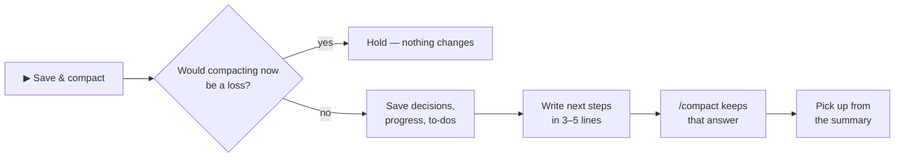

<p align="center">
  
</p>

<h1 align="center">easy-compact</h1>

<p align="center">
  <b>See what every request costs. Know when to compact. Compact in one click — without losing your place.</b><br>
  Claude Code plugin · desktop app and terminal · tested on Windows
</p>

<p align="center">
  
  
  
  
</p>

<p align="center">
  <b>English</b> · <a href="README.ko.md">한국어</a>
  &nbsp;|&nbsp;
  <a href="#install">Install</a> · <a href="#update">Update</a> · <a href="#whats-new-in-040">What's new</a> · <a href="#features">Features</a> · <a href="#hide-fold-bring-it-back">Hide · bring back</a>
</p>

---

## Install

**First time only.** Claude Code **2.1.295 or later**. The desktop app and the terminal share the same settings, so installing once works in both.

**Easiest — send this one line to Claude** (in the desktop app's Code tab or a terminal session):

```
Install this plugin: github.com/JaeSeongHa5280/easy-compact (claude plugin marketplace add JaeSeongHa5280/easy-compact, then claude plugin install easy-compact@easy-compact)
```

Then quit the Claude app completely and open it again (or start a new `claude` session). The Easy Compact bar appears above the input.

<details>
<summary><b>Type it yourself</b></summary>

**In Claude's input box — send each line on its own.** Send the second line after the first one finishes. Pasting both lines in one message doesn't install.

```
/plugin marketplace add JaeSeongHa5280/easy-compact
```

```
/plugin install easy-compact@easy-compact
```

- **Desktop app:** the first line opens **Add marketplace** — click **Sync**. The red warning there is the standard notice for any marketplace Anthropic doesn't run. The second line opens easy-compact in the plugin list — install it.
- **Terminal session:** the second line opens the plugin's details — choose **Install for you**.

**In a shell (PowerShell · terminal command line):**

```
claude plugin marketplace add JaeSeongHa5280/easy-compact
claude plugin install easy-compact@easy-compact
```

No `claude` command (usual if you only use the desktop app)? Send the one line above to Claude.

</details>

> **Note for Claude:** if `claude` is not on PATH (usual in the desktop app), run it with the running engine — on Windows, in PowerShell: `& (Get-Process -Id $env:CLAUDE_PID).Path plugin install easy-compact --marketplace JaeSeongHa5280/easy-compact`. To update an existing install, run `plugin marketplace update easy-compact` first, then `plugin update easy-compact@easy-compact` (same engine path) — without the first step it reports the old version as the latest. Check `plugin list` shows `easy-compact@easy-compact` enabled, then ask the user to quit and reopen the app. Don't clone this repository or edit `settings.json`.

## Update

**Already installed? Send this one line to Claude**, then restart Claude:

```
Update this plugin: easy-compact (claude plugin marketplace update easy-compact, then claude plugin update easy-compact@easy-compact)
```

To do it yourself in a shell, these two lines:

```
claude plugin marketplace update easy-compact
claude plugin update easy-compact@easy-compact
```

- Typing the install lines again only says *already installed*, and `plugin update` alone reports the old version as the latest — the first line fetches the new list.
- Your settings (compact range, pane view and so on) stay as they were.
- **Get new versions automatically:** in a terminal session, `/plugin` → **Marketplaces** → **easy-compact** → **Enable auto-update**. It is off for marketplaces Anthropic doesn't run ([Claude Code docs](https://code.claude.com/docs/en/plugins/install)).
- Your version: `claude plugin list`. What changed: [CHANGELOG](CHANGELOG.md) · [releases](https://github.com/JaeSeongHa5280/easy-compact/releases).

<details>
<summary><b>Remove</b></summary>

```
claude plugin uninstall easy-compact@easy-compact
```

No cloning into `~/.claude` and no `settings.json` edits are involved. Just want a break? [Turn the bar off](#hide-fold-bring-it-back) instead.

</details>

## What's new in 0.4.0

- **This session's cost, always on the bar** — first on the cost row, in both sizes. It turns yellow · orange · red at $10 · $50 · $100 (change them under Custom).
- **Four screens** at the top of Settings — **Simple** (just getting started: session cost, context and the Easy Compact button), **Basic**, **Detailed** (every figure, the detailed pane) and **Custom** (choose every part yourself). Presets show their details read-only.
- **Cache lifetime read from the session** — 1 hour on a subscription within its limits, 5 minutes on an API key or over the plan (Claude Code's defaults; `promptCacheTtl` changes it). Minutes left show as `42/60m`, the warning is set per lifetime, and the cost of re-sending a cold cache uses that lifetime's write rate (5-minute writes are 1.25× input, 1-hour writes 2×). The timer restarts with every request — it used to count down through a long answer.
- **✕ folds the bar; it opens by itself when it's time to compact** (Settings → **Bar · pane**). The ⇲ auto-hide button is gone — it did the same thing.
- **🤖 Subagent cost on its own** — on the bar, under answers and in the working line: `🤖 $1.93 · 6 requests · running`. An opened question splits into main / 🤖 agents / 🗜 compact / ⚙ app's own requests.
- **Simple Usage pane** — a cost summary and cost per question; **Detailed** adds the graphs and compact effects.
- **Costs that show the model difference** — per request is the real cost (read + new writes + output), the cost table has a **per question** column, and *the same questions on Sonnet 5.5 ~$X*.
- **Cold-cache math fixed** — the system prompt and tools other sessions keep warm count as reads. A cold cache always opens the *compact now* card (it says so when that costs more). Past compacts and summary sizes follow the real cache state too.
- **Cache minutes always shown** — even right after a compact. Compact-timing labels no longer overlap in a narrow pane.
- **New installs start at 200k–250k** — counting compacts correctly moved the best size down. Existing users keep their range (Settings marks the suggestion with ★).
- API-key sessions (no plan limits) move the cost line to the top row. The limits row can be turned off as a whole or part by part.

Full list: [CHANGELOG](CHANGELOG.md).

## Why

Claude Code re-reads the whole context on every request — a session at 300k pays for 300k on every step, and nothing on screen tells you.

| Without | With easy-compact |
|---|---|
| Typing `/context` again and again | Context and cost **always on screen** |
| *"What did that cost?"* | Cost per **request, question and step** |
| *"Compact now or later?"* | 🟡 **Good time** · 🔴 **Overdue** · grey 🗜 = not yet |
| *"Where were we?"* after a compact | **Next steps kept** in the summary |

## Demo · 58 s

https://github.com/user-attachments/assets/265a46aa-b564-4041-98d1-a458c4a27d83

## Features

### 1. Live cost, right above the input


**Context, next-request cost and this question's cost — updated after every request.**
Also on the bar: this session's cost so far (yellow · orange · red at $10 · $50 · $100), your 5-hour and 7-day plan usage, minutes left on the prompt cache (`42/60m` — left / lifetime), the **Easy Compact** button, and the window buttons (top right). Too much on screen? Pick a smaller **Screen** in Settings (Simple shows only the session cost, context and the Easy Compact button), shrink the bar to one line, or fold it until it's time to compact — see [Hide, fold, bring it back](#hide-fold-bring-it-back). To choose single parts, pick **Custom** under Settings → **Screen** → **Details**. Subagent spending shows up separately with 🤖.

### 2. Cost per question, step by step


**While Claude works, every step gets its own line and price.**


**Open any finished question:** main (read / write / output) · 🤖 agents · 🗜 compact · ⚙ app's own requests, then each step. `(+42k)` is how much context that question added.

### 3. Know when to compact


**Pick a compact range from a cost table.** Each size shows one read, one question (this session's question shape × the current model's rates), the cost when the cache has gone cold, and how far it is from the cheapest size (★).

| Next to 🗜 | Means |
|---|---|
| Grey 🗜 · plain **Easy Compact** | Not now — before your range, right after a compact, or compacting would cost more. Hover for the reason |
| 🟡 *Good time to compact* | Inside your range |
| 🔴 *Compact overdue* | Past your range |
| 🔵 *Cache expired · compact now advised* | The cache went cold, and compacting now is cheaper than re-sending everything |

### 4. Save & compact — one click


**"Compact now?" shows what you save per question and what the compact costs.** With a cold cache it's the 🧊 *Cache expired* card — continuing vs compacting now, with ▶ Compact now as the main button (a save question would first re-send everything). Then:




**After the compact, the next steps are in the summary — and every request costs less.** *Compact now* skips the save step.

### 5. Usage pane

Open it with **📊** on the bar. **Simple** (on the Simple and Basic screens): this session's cost summary — questions, average, main / 🤖 / ⚙, a "now" line, the compact call, what another model would have cost — plus cost per question. **Detailed**: also the context bar, compact timing, context flow and what each compact saved. Switch with **Simple · Detailed** at the top of the pane (for this session; the screen sets the default). By default it opens and closes together across your open desktop sessions, and doesn't open by itself in new sessions — both are in Settings → **Bar · pane**.

### 6. Terminal too


**The same bar and Usage pane in the CLI.** To press the bar's buttons, press ctrl+x tab to move into the bar (or click, in fullscreen mode).

## Hide, fold, bring it back

The window buttons sit at the top right of the bar. Every choice applies to all sessions and stays after a restart.

| Button | What it does | How it comes back |
|---|---|---|
| **—** / **□** | One line / full | Press it again |
| **✕** fold | Folds the bar below the input in every session | By itself when it's time to compact (yellow · cache expired) — or press **🔽 Easy Compact ⇱** below the input, or type `/easy-compact show` |
| **📊** | Opens or closes the Usage pane | Press it again |

Whether a folded bar opens by itself is **Open by itself** under Settings → **Bar · pane** (on by default). Turn it off and the bar stays folded — the button below the input turns grey (*closed*) — until you press it: a pause before you decide to uninstall. Folding an opened-by-itself bar again keeps it folded until things get more urgent (red · cache expired).


**There are only two commands: `/easy-compact show` · `hide`** — use `show` to open a folded bar. Everything else is on the bar's buttons and the **⚙ Settings** tab of the 📊 pane. Settings open with only the **Screen** section (Simple · Basic · Detailed · Custom); the others are folded, with the current value on each title. The cache lifetime itself (`promptCacheTtl` in your settings file) can be changed only under **Custom** — choosing it without knowing the trade-off just costs more.

**Buttons cost nothing.** Typed commands don't call the model either, but the command and its one-line answer stay in the conversation, so they are re-sent with your next request.

## Good to know

- **Amounts are API list-price estimates.** On a subscription they show how heavy a session is, not what you are billed.
- **Everything stays on your machine.** It reads your local session records and makes no network requests.
- **Platforms:** built and tested on Windows. Nothing in it is Windows-specific, but macOS and Linux are untested — reports welcome.
- **Desktop app:** right after the pane opens, the first click inside it only moves focus — click once more.
- Records over 4 MB are read with Node.js — keep `node` on your PATH for very long sessions.

## License

[MIT](LICENSE)
