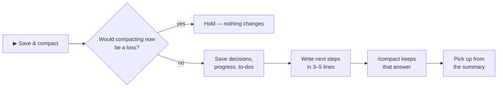

<p align="center">
  
</p>

<h1 align="center">easy-compact</h1>

<p align="center">
  <b>See what every request costs. Know when to compact. Compact in one click — without losing your place.</b><br>
  Claude Code plugin · desktop app and terminal · tested on Windows
</p>

<p align="center">
  
  
  
  
</p>

<p align="center">
  <b>English</b> · <a href="README.ko.md">한국어</a>
  &nbsp;|&nbsp;
  <a href="#install">Install</a> · <a href="#update">Update</a> · <a href="#whats-new-in-030">What's new</a> · <a href="#features">Features</a> · <a href="#hide-fold-bring-it-back">Hide · bring back</a>
</p>

---

## Install

**First time only.** Claude Code **2.1.295 or later**. The desktop app and the terminal share the same settings, so installing once works in both.

In Claude Code — the desktop app's Code tab or the terminal — type these one at a time:

```
/plugin marketplace add JaeSeongHa5280/easy-compact
/plugin install easy-compact@easy-compact
```

- **Desktop app:** the first line opens **Add marketplace** — click **Sync**. The red warning there is the standard notice for any marketplace Anthropic doesn't run. The second line opens easy-compact in the plugin list — install it.
- **Terminal:** the second line opens the plugin's details — choose **Install for you**.

Then quit the Claude app completely and open it again (or start a new `claude` session). The Easy Compact bar appears above the input.

**Or just ask Claude:** send `Install https://github.com/JaeSeongHa5280/easy-compact` in a Code session.

> **Note for Claude:** if `claude` is not on PATH (usual in the desktop app), run it with the running engine — on Windows, in PowerShell: `& (Get-Process -Id $env:CLAUDE_PID).Path plugin install easy-compact --marketplace JaeSeongHa5280/easy-compact`. To update an existing install, run `plugin marketplace update easy-compact` first, then `plugin update easy-compact@easy-compact` (same engine path) — without the first step it reports the old version as the latest. Check `plugin list` shows `easy-compact@easy-compact` enabled, then ask the user to quit and reopen the app. Don't clone this repository or edit `settings.json`.

## Update

**Already installed? Copy these two lines** into a terminal, then restart Claude:

```
claude plugin marketplace update easy-compact
claude plugin update easy-compact@easy-compact
```

- Typing the install lines again only says *already installed*, and `plugin update` alone reports the old version as the latest — the first line fetches the new list.
- **Desktop app only, no `claude` command?** Send `Update https://github.com/JaeSeongHa5280/easy-compact` to Claude in a Code session.
- **Get new versions automatically:** in a terminal session, `/plugin` → **Marketplaces** → **easy-compact** → **Enable auto-update**. It is off for marketplaces Anthropic doesn't run ([Claude Code docs](https://code.claude.com/docs/en/plugins/install)).
- Your version: `claude plugin list`. What changed: [CHANGELOG](CHANGELOG.md) · [releases](https://github.com/JaeSeongHa5280/easy-compact/releases).

<details>
<summary><b>Remove</b></summary>

```
claude plugin uninstall easy-compact@easy-compact
```

No cloning into `~/.claude` and no `settings.json` edits are involved. Just want a break? [Turn the bar off](#hide-fold-bring-it-back) instead.

</details>

## What's new in 0.3.0

- **Window buttons on the bar** — 📊 Usage pane · ⇲ auto-hide · — / □ one line / full · ✕ off, with a hint on hover.
- **🔽 Easy Compact ⇱ below the input** brings a folded or turned-off bar back. Turning it off tells you how to turn it on again.
- **A grey 🗜 means "not now"** — before your range, right after a compact, or when compacting would cost more. Hover for the reason; the card still shows the numbers.
- **Cache expiry fixed:** reopening a session no longer hides an expired cache, so *Cache expired · compact now advised* appears when it should.
- Usage pane options: open by itself in new sessions · open and close together across sessions.

Full list: [CHANGELOG](CHANGELOG.md).

## Why

Claude Code re-reads the whole context on every request — a session at 300k pays for 300k on every step, and nothing on screen tells you.

| Without | With easy-compact |
|---|---|
| Typing `/context` again and again | Context and cost **always on screen** |
| *"What did that cost?"* | Cost per **request, question and step** |
| *"Compact now or later?"* | 🟡 **Good time** · 🔴 **Overdue** · grey 🗜 = not yet |
| *"Where were we?"* after a compact | **Next steps kept** in the summary |

## Demo · 58 s

https://github.com/user-attachments/assets/265a46aa-b564-4041-98d1-a458c4a27d83

## Features

### 1. Live cost, right above the input


**Context, next-request cost and this question's cost — updated after every request.**
Also on the bar: your 5-hour and 7-day plan usage, minutes left on the prompt cache, the **Easy Compact** button, and the window buttons (top right). Too much on screen? Shrink it to one line, auto-hide it until it's time to compact, or turn it off — see [Hide, fold, bring it back](#hide-fold-bring-it-back). To hide single parts of the full bar, open Settings → **Easy Compact bar** → **UI layout details**.

### 2. Cost per question, step by step


**While Claude works, every step gets its own line and price.**


**Open any finished question:** read / write / output, then each step. `(+42k)` is how much context that question added.

### 3. Know when to compact


**Pick a compact range from a cost table.** Each size shows the per-request cost, the cost when the cache has gone cold, and how far it is from the cheapest size (★).

| Next to 🗜 | Means |
|---|---|
| Grey 🗜 · plain **Easy Compact** | Not now — before your range, right after a compact, or compacting would cost more. Hover for the reason |
| 🟡 *Good time to compact* | Inside your range |
| 🔴 *Compact overdue* | Past your range |
| 🔵 *Cache expired · compact now advised* | The cache went cold, and compacting now is cheaper than re-sending everything |

### 4. Save & compact — one click


**"Compact now?" shows what you save per question and what the compact costs** (or, with a cold cache, continuing vs compacting now). Then:




**After the compact, the next steps are in the summary — and every request costs less.** *Compact now* skips the save step.

### 5. Usage pane

Open it with **📊** on the bar: cost per question and step, the context flow, and what each compact saved. By default it opens and closes together across your open desktop sessions, and doesn't open by itself in new sessions — both are in Settings → **Usage pane**.

### 6. Terminal too


**The same bar and Usage pane in the CLI.** To press the bar's buttons, press ctrl+x tab to move into the bar (or click, in fullscreen mode).

## Hide, fold, bring it back

The window buttons sit at the top right of the bar. Every choice applies to all sessions and stays after a restart.

| Button | What it does | How it comes back |
|---|---|---|
| **⇲** auto-hide | Folds the bar until the context reaches your compact range (yellow) | By itself at yellow — or press **🔽 Easy Compact ⇱** below the input |
| **—** / **□** | One line / full | Press it again |
| **✕** off | Turns the bar off in every session — a pause before you decide to uninstall | Press **🔽 Easy Compact closed ⇱** (grey) below the input, or type `/easy-compact show` |
| **📊** | Opens or closes the Usage pane | Press it again |


**There are only two commands: `/easy-compact show` · `hide`** — use `show` to turn the bar back on after turning it off. Everything else is on the bar's buttons and the **⚙ Settings** tab of the 📊 pane. Settings sections start folded, with the current value on each title.

**Buttons cost nothing.** Typed commands don't call the model either, but the command and its one-line answer stay in the conversation, so they are re-sent with your next request.

## Good to know

- **Amounts are API list-price estimates.** On a subscription they show how heavy a session is, not what you are billed.
- **Everything stays on your machine.** It reads your local session records and makes no network requests.
- **Platforms:** built and tested on Windows. Nothing in it is Windows-specific, but macOS and Linux are untested — reports welcome.
- **Desktop app:** right after the pane opens, the first click inside it only moves focus — click once more.
- Records over 4 MB are read with Node.js — keep `node` on your PATH for very long sessions.

## License

[MIT](LICENSE)
